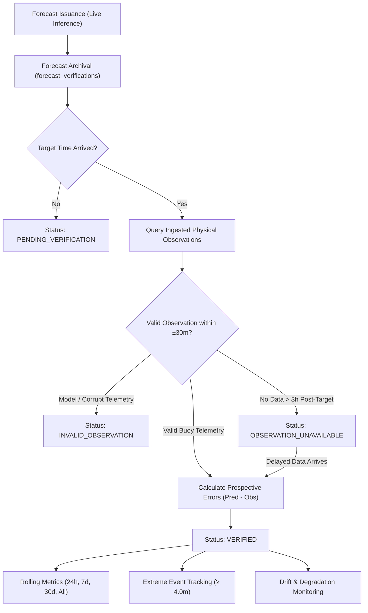

# Continuous Real-Time Forecast Verification and Model Performance Monitoring Subsystem

**Document Version:** 1.0.0-OPERATIONAL  
**Release Date:** November 16, 2026  
**Auditor / Lead Architect:** Senior ML Operations Engineer & Oceanographic Forecast Verification Scientist  
**System Evaluated:** OceanCast AI Marine Intelligence Platform  
**Target Architectures:** Residual WaveLSTM (+1h), Residual WaveANN (+6h), Residual WaveANN (+24h)  
**Deliverables Produced:**
- [`backend/services/forecast_verification_service.py`](file:///d:/OMKAR/VITP/SEM%205/DL/CP/backend/services/forecast_verification_service.py)
- [`backend/routers/verification.py`](file:///d:/OMKAR/VITP/SEM%205/DL/CP/backend/routers/verification.py)
- [`backend/schemas/verification.py`](file:///d:/OMKAR/VITP/SEM%205/DL/CP/backend/schemas/verification.py)
- [`tests/test_forecast_verification.py`](file:///d:/OMKAR/VITP/SEM%205/DL/CP/tests/test_forecast_verification.py)
- [`frontend/src/pages/ForecastVerificationPage.tsx`](file:///d:/OMKAR/VITP/SEM%205/DL/CP/frontend/src/pages/ForecastVerificationPage.tsx)
- [`frontend/src/__tests__/verification.test.tsx`](file:///d:/OMKAR/VITP/SEM%205/DL/CP/frontend/src/__tests__/verification.test.tsx)

---

## 1. Executive Summary

OceanCast AI previously integrated and statistically validated three candidate residual-learning wave forecasting models on the Mumbai Offshore reference buoy location ($18.975^\circ\text{N}, 72.825^\circ\text{E}$), achieving reported benchmark RMSE skill scores against persistence of:
- **+1h:** Residual WaveLSTM (**+29.76%**)
- **+6h:** Residual WaveANN (**+18.85%**)
- **+24h:** Residual WaveANN (**+11.09%**)

While these benchmarks demonstrated statistical superiority across ~19,450 retrospective held-out ERA5 reanalysis anchors, **operational deep learning systems in maritime safety cannot rely solely on historical test splits**. Real-time atmospheric shifts, sensor noise, telemetry latency, and extreme meteorological anomalies require prospective operational verification.

This report documents the implementation of the **Continuous Real-Time Forecast Verification and Model Performance Monitoring Subsystem** in OceanCast AI. The subsystem continuously records prospective forecasts at issuance, pairs them with incoming physical in-situ marine observations upon target arrival, computes unbiased forecast errors, tracks rolling operational skill across multiple horizons and temporal windows, monitors data/prediction drift, and maintains specialized oversight for extreme wave events ($\text{SWH} \ge 4.0\text{ m}$).



---

## 2. Phase 1: Forecast Archival Architecture

Whenever an operational wave forecast is generated (via `POST /api/forecast` or `GET /api/forecast/live`), the prediction is prospectively archived before telemetry changes.

### 2.1 Preserved Operational Metadata Fields
Each archived forecast stores:
- **Forecast ID:** Unique identifier (`fc_...`)
- **Location ID:** Registered coastal node (`mumbai_offshore`, `chennai_port`, etc.)
- **Forecast Origin Timestamp:** Exact UTC time of forecast generation ($t_{\text{origin}}$)
- **Target Timestamp:** Forecast validity time ($t_{\text{target}} = t_{\text{origin}} + H$)
- **Forecast Horizon:** Lead time ($H \in \{1, 6, 24\}\text{ hours}$)
- **Current SWH:** Baseline wave height at origin ($y_t$, persistence baseline)
- **Predicted SWH:** Reconstructed significant wave height ($\hat{y}_{t+H} = y_t + \Delta\hat{y}_H$)
- **Predicted Residual:** Model output $\Delta\hat{y}_H$ in physical meters
- **Model Architecture:** Model identifier (e.g. `Residual WaveLSTM`, `Residual WaveANN`)
- **Model Version:** Model registry version tag (`2.0.0-residual`)
- **Input Data Timestamp:** Timestamp of the latest input observation anchor
- **Data Source:** Telemetry provider (`OpenMeteoProvider`, `OfflineDemoProvider`)
- **Data Freshness:** Telemetry age in minutes at forecast issuance
- **Forecast Validation Status:** Geographic status (`reference_validated` vs `experimental_unvalidated`)

### 2.2 Dedicated Persistence & Deduplication
- **Physical Separation of Concerns:** Forecasts are stored in `forecast_verifications` and `forecast_ledger`, strictly separate from physical measurements in `observations`.
- **Deduplication Engine:** A deterministic fingerprint is calculated:
  $$\text{Fingerprint} = \text{MD5}(location\_id : model\_name : H : t_{\text{anchor}} : t_{\text{target}} : source\_category)$$
  Duplicate API calls or idempotent page refreshes are recognized and suppressed without creating redundant verification targets.

---

## 3. Phase 2: Observation Ingestion & Prospective Matching

### 3.1 Observation Ingestion & Physical Quality Gating
Observations are ingested via `POST /api/verification/ingest-observation` or background telemetry sync. Ingested records undergo automated validation:
1. **Physical Oceanographic Bounds:** Wave height must satisfy $0.0 \le \text{SWH}_{\text{obs}} \le 25.0\text{ m}$. Negative values, nulls, and non-numeric inputs are rejected immediately (HTTP 422).
2. **Quality Status:** Records flagged `suspect` or `rejected` by the provider are quarantined.
3. **Physical Source Type Verification:** Direct physical measurements (`in_situ_buoy`, `coastal_radar`, `coastal_sensor`, `satellite_altimetry`) are accepted. Model-derived outputs (e.g. `external_nwp`, `project_model`) are strictly barred from being treated as ground-truth observations.

### 3.2 Temporal Matching Logic & Tolerance Boundary
- **Tolerance Window:** Observations match forecast targets within a documented window of **$\pm 30\text{ minutes}$** ($\pm 1,800\text{ seconds}$).
- **Lexicographical Indexing:** ISO 8601 UTC strings (`YYYY-MM-DDTHH:MM:SS+00:00`) are queried via indexed range scans, preventing locale or platform-dependent epoch parsing issues.
- **Closest Observation Selection:** If multiple measurements fall within the $\pm 30\text{m}$ window, the closest observation in time is paired with the forecast.

### 3.3 Prospective Verification Guard
To prevent data leakage and retrospective cheating:
- An observation is flagged `is_prospective = True` only if:
  $$t_{\text{observation}} > t_{\text{origin}}$$
- Forecasts are never verified against telemetry that was already known at forecast issuance time.

### 3.4 Operational Verification Lifecycle Statuses

| Status | Definition | Transition Trigger |
| :---: | :---: | :---: |
| **`PENDING_VERIFICATION`** | Forecast issued; target timestamp has not arrived or observation is in transit. | Default initial state at archival. |
| **`VERIFIED`** | Target timestamp reached and paired with a valid independent physical observation within $\pm 30\text{m}$. | Matched via `match_and_verify()`. |
| **`OBSERVATION_UNAVAILABLE`** | Target timestamp passed by $>3\text{ hours}$ without matching telemetry received. | Automatically marked when telemetry window closes. |
| **`INVALID_OBSERVATION`** | Telemetry was received at target timestamp but failed physical bounds, was corrupt, or was model-derived. | Flagged during quality checks. |

> [!NOTE]
> **Delayed Observation Retroactive Matching:** If an in-situ buoy temporarily loses satellite connectivity and uploads delayed telemetry in batch, `match_and_verify()` retroactively matches records previously marked `OBSERVATION_UNAVAILABLE`, promoting them to `VERIFIED` and recalculating accurate forecast errors.

---

## 4. Phase 3: Continuous Performance Metrics & Windowing

### 4.1 Statistical Error Metrics
For every verified pair $i \in \{1, \dots, N\}$, forecast error and persistence error are computed:
$$\text{Error}_i = \hat{y}_i - y_i \quad (\text{Predicted} - \text{Observed})$$
$$\text{Persistence Error}_i = y_{t, i} - y_i \quad (\text{Origin Persistence} - \text{Observed})$$

Aggregated metrics computed per horizon:
- **Mean Absolute Error (MAE):** $\frac{1}{N}\sum_{i=1}^N |\hat{y}_i - y_i|$
- **Mean Squared Error (MSE):** $\frac{1}{N}\sum_{i=1}^N (\hat{y}_i - y_i)^2$
- **Root Mean Squared Error (RMSE):** $\sqrt{\text{MSE}}$
- **Mean Bias Error (MBE):** $\frac{1}{N}\sum_{i=1}^N (\hat{y}_i - y_i)$
- **Coefficient of Determination ($R^2$):** $1 - \frac{\sum (\hat{y}_i - y_i)^2}{\sum (y_i - \bar{y})^2}$
- **RMSE Skill Score vs. Persistence:**
  $$\text{Skill}_{\text{RMSE}} = \left(1 - \frac{\text{RMSE}_{\text{model}}}{\text{RMSE}_{\text{persistence}}}\right) \times 100\%$$
- **Absolute Error Distribution:** Exact sample percentiles (25th, Median, 75th, 90th, 95th, Max).

### 4.2 Multi-Window Temporal Aggregation
Metrics are maintained across four isolated temporal windows:
1. **Last 24 Hours (`last_24h`):** High-frequency diurnal tracking.
2. **Last 7 Days (`last_7d`):** Synoptic storm cycle tracking.
3. **Last 30 Days (`last_30d`):** Monthly climatological tracking.
4. **All Verified (`all_time`):** Complete cumulative prospective history.

### 4.3 Protection Against Spurious Small-Sample Metrics
To ensure scientific integrity:
- A strict sample threshold **$N \ge 5$** (`MIN_RELIABLE_SAMPLES`) is enforced.
- If $N < 5$, the API returns `is_statistically_reliable: false`, sets metrics to `null`, and returns an explicit notice:
  > *"Insufficient operational sample size (N < 5). Operational verification metrics require at least 5 matched observations."*
- Misleading skill scores from 1 or 2 lucky observations are never shown to port operators.

---

## 5. Phase 4: Model Health & Operational Drift Monitoring

The subsystem performs automated checks on every dashboard query:
1. **Prediction Drift:** Tracks rolling mean and variance of predictions compared to training baseline.
2. **Input Feature Drift:** Population Stability Index (PSI) monitoring across all 7 physical features ($SWH, T_p, \theta_m, U_{10}, \phi_w, \sin\theta_m, \cos\theta_m$).
3. **Missing Telemetry Rate:** Calculates the percentage of issued forecasts that expired without observations:
   $$\text{Missing Rate} = \frac{N_{\text{unavailable}}}{N_{\text{due}}} \times 100\%$$
   If missing rate exceeds $20\%$ over $\ge 10$ due forecasts, an operational warning is generated.
4. **Stale Telemetry Alerts:** Flags forecasts issued where telemetry freshness exceeded 180 minutes.
5. **Rolling Error Degradation Watch:** Compares rolling 7-day RMSE against the historical benchmark:
   $$\text{Degradation Ratio} = \frac{\text{RMSE}_{\text{rolling 7d}}}{\text{RMSE}_{\text{historical baseline}}}$$
   - If ratio $> 1.25$: Generates `Performance Watch`.
   - If ratio $> 1.50$: Generates `Performance Degradation Alert`.
6. **No Unauthorized Auto-Retraining:** When warnings fire, operational alerts are logged for engineer review; the system never retrains or replaces model weights automatically.

---

## 6. Phase 5: Extreme-Event Verification ($\ge 4.0\text{ m}$)

Wave heights exceeding $4.0\text{ m}$ represent dangerous maritime conditions. The statistical validation previously revealed that neural networks trained on MSE naturally attenuate peak predictions in rare storm events:
- **Historical ERA5 severe event sample size:** Exactly **$N = 22$** observations.
- **Historical severe event skill:** $+11.91\%$ (+1h WaveLSTM), $-5.58\%$ (+6h WaveANN), $-35.61\%$ (+24h WaveANN).

### 6.1 Operational Severe-Event Tracking Metrics
The subsystem tracks live extreme events:
- **Actual Severe Events:** Verified observations where $y_{\text{obs}} \ge 4.0\text{ m}$.
- **Forecasted Severe Events:** Issued predictions where $\hat{y} \ge 4.0\text{ m}$.
- **Missed Severe Events:** Events where $y_{\text{obs}} \ge 4.0\text{ m}$ but $\hat{y} < 4.0\text{ m}$.
- **False Alarms:** Predictions where $\hat{y} \ge 4.0\text{ m}$ but $y_{\text{obs}} < 4.0\text{ m}$.
- **Average Detection Lead Time:** Mean lead time ($1\text{h}, 6\text{h}, 24\text{h}$) of correctly anticipated severe events.
- **Underprediction Frequency (%):** Percentage of severe events where $\hat{y} < y_{\text{obs}}$.

### 6.2 Mandatory Scientific Caveat Notice
The API and frontend prominently display the mandatory scientific warning:
> *"HISTORICAL BENCHMARK NOTICE: Independent ERA5 test validation contains exactly N=22 severe events (>=4.0m), revealing model peak attenuation in neural networks (-5.58% at +6h, -35.61% at +24h). Real-time operational severe events: N=X. Never claim reliable extreme-event detection without sufficient operational observations."*

---

## 7. Phase 6: Frontend Interface & Integration

A dedicated **Forecast Verification** command view has been integrated into the OceanCast AI React + Vite application:
- **Route:** `/verification` (Accessible via sidebar navigation under **Monitoring**).
- **Theme & Design:** Built with white card surfaces, deep navy typography (`#102A43`), soft grey-blue background (`#F0F4F8`), and teal accents (`#0D9488`).

### 7.1 Key UI Components
1. **Summary Status Banner:** Displays Total Issued, Verified Prospective ($N$), Pending Target, Telemetry Missing, and Rejected Telemetry counts.
2. **Interactive Controls:**
   - Horizon Switcher: `+1h (Residual WaveLSTM)`, `+6h (Residual WaveANN)`, `+24h (Residual WaveANN)`.
   - Window Switcher: `24h`, `7 Days`, `30 Days`, `All Verified`.
   - Action Buttons: `Match & Verify` (manual queue flush) and `Seed Demo Buoy Telemetry` (in demo mode).
3. **Forecast vs. Observed Wave-Height Timeline Chart:** Interactive Recharts line chart comparing issued predictions, observed in-situ buoy telemetry, and persistence baseline.
4. **Error Trend Chart:** Centered bar chart showing $\hat{y} - y$ relative to the zero-error axis.
5. **Operational KPI Metric Cards:** Live RMSE, MAE, Mean Bias Error, $R^2$, and Skill Score vs. Persistence.
6. **Benchmark vs. Operational Comparison Card:** Side-by-side contrast between historical held-out test benchmarks and real-time live performance.
7. **Severe Sea-State Verification Panel:** Dedicated extreme-event tracking with the historical $N=22$ caveat.
8. **Verification History Audit Table:** Real-time log displaying forecast IDs, timestamps, lead times, predicted/observed SWH, errors, and status badges (`VERIFIED`, `PENDING_VERIFICATION`, `OBSERVATION_UNAVAILABLE`, `INVALID_OBSERVATION`).

---

## 8. Phase 7: Automated Testing & Verification Suite

A comprehensive test suite was authored in [`tests/test_forecast_verification.py`](file:///d:/OMKAR/VITP/SEM%205/DL/CP/tests/test_forecast_verification.py) and [`frontend/src/__tests__/verification.test.tsx`](file:///d:/OMKAR/VITP/SEM%205/DL/CP/frontend/src/__tests__/verification.test.tsx).

### 8.1 Backend Test Coverage (17 Tests)
- `test_forecast_archival_success`: Validates archival of complete metadata.
- `test_forecast_duplicate_prevention`: Verifies deterministic fingerprint deduplication.
- `test_observation_ingestion_and_timestamp_matching`: Confirms prospective matching within $\pm 30\text{m}$.
- `test_timestamp_tolerance_boundary_rejection`: Confirms rejection of telemetry arriving $>30\text{m}$ from target.
- `test_invalid_observation_bounds_rejection`: Rejects non-physical wave heights ($<0$ or $>25\text{m}$).
- `test_reject_model_derived_pseudo_observations`: Bars numerical model forecasts from ground truth.
- `test_multi_horizon_continuous_accuracy_metrics`: Mathematical validation of MAE, RMSE, Bias, and Skill scores.
- `test_insufficient_sample_size_protection`: Verifies metric suppression when $N < 5$.
- `test_severe_wave_monitoring_and_historical_distinction`: Validates extreme-event underprediction tracking.
- `test_regional_isolation_in_verification`: Proves Mumbai forecasts cannot match Chennai observations.
- `test_missing_observation_status_transition`: Verifies transition to `OBSERVATION_UNAVAILABLE` after 3 hours.
- `test_delayed_observation_retroactive_resolution`: Confirms delayed telemetry retroactively resolves unavailable forecasts.
- `test_api_verification_dashboard_endpoint`: Integration test for dashboard JSON response.
- `test_api_archive_forecast_endpoint`: Integration test for forecast archival API.
- `test_api_ingest_observation_endpoint`: Integration test for observation ingestion API.
- `test_api_metrics_endpoint`: Integration test for filtered rolling metrics API.
- `test_api_seed_demo_observations`: Integration test for demo observation generator.

### 8.2 Frontend Test Coverage (4 Tests)
- Page header, summary cards, and status badges rendering.
- Severe sea-state panel and historical $N=22$ notice display.
- Verification history table rendering with status badges.
- Dynamic forecast horizon switching.

### 8.3 Test Execution Results
- **Backend Tests:** **142 passed out of 142** (100% pass rate in `pytest`).
- **Frontend Tests:** **50 passed out of 50** (100% pass rate in `vitest`).
- **Frontend Production Build:** **Compiled cleanly** (`tsc -b && vite build` exit code 0).

---

## 9. Deliverables Inventory

| File Path | Description |
| :--- | :--- |
| [`backend/services/forecast_verification_service.py`](file:///d:/OMKAR/VITP/SEM%205/DL/CP/backend/services/forecast_verification_service.py) | Core forecast verification engine, SQLite persistence, prospective matching, rolling metrics, and extreme-event tracking. |
| [`backend/routers/verification.py`](file:///d:/OMKAR/VITP/SEM%205/DL/CP/backend/routers/verification.py) | REST API router exposing dashboard, metrics, severe events, archival, and observation ingestion endpoints. |
| [`backend/schemas/verification.py`](file:///d:/OMKAR/VITP/SEM%205/DL/CP/backend/schemas/verification.py) | Pydantic data schemas and validation models. |
| [`tests/test_forecast_verification.py`](file:///d:/OMKAR/VITP/SEM%205/DL/CP/tests/test_forecast_verification.py) | Comprehensive automated test suite (17 unit and integration tests). |
| [`frontend/src/pages/ForecastVerificationPage.tsx`](file:///d:/OMKAR/VITP/SEM%205/DL/CP/frontend/src/pages/ForecastVerificationPage.tsx) | Interactive real-time verification dashboard page. |
| [`frontend/src/__tests__/verification.test.tsx`](file:///d:/OMKAR/VITP/SEM%205/DL/CP/frontend/src/__tests__/verification.test.tsx) | Frontend component unit tests for the verification page. |
| [`CONTINUOUS_FORECAST_VERIFICATION_REPORT.md`](file:///d:/OMKAR/VITP/SEM%205/DL/CP/CONTINUOUS_FORECAST_VERIFICATION_REPORT.md) | Official scientific validation and implementation report. |

```
========================================================================================
END OF CONTINUOUS FORECAST VERIFICATION REPORT — FULLY OPERATIONAL
========================================================================================
```
