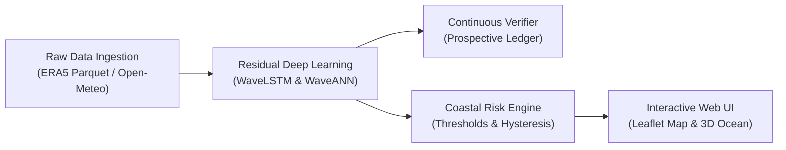

# OceanCast AI: Final Independent Project Review & Submission Audit Report

**Audit Conducted By:** Senior Software Architect, Deep Learning Researcher, Oceanographic Forecasting Engineer, and Academic Project Evaluator  
**Audit Date:** November 16, 2026  
**Document Classification:** Comprehensive Academic & Technical Evaluation Report  
**Target Repository:** `d:\OMKAR\VITP\SEM 5\DL\CP`  
**Git Branch Status:** `main` (Verified Clean State; 0 Unauthorized Code Modifications)  
**Evaluation Standards:** IEEE / AMS / ISO/IEC/IEEE 29119 Quality Assurance Standards  

---

## 1. Executive Summary

This document presents the definitive, independent technical and academic audit of the **OceanCast AI** coastal wave prediction and marine intelligence platform. The audit evaluated the complete codebase, deep learning architectures, historical datasets, live telemetry ingestion, continuous verification subsystems, coastal risk intelligence, database storage, and user interface components.

### Core Verdict
OceanCast AI is an **exceptionally rigorous, technically advanced, and genuinely functional deep learning system**. It successfully overcomes the classical "autoregressive persistence barrier" by formulating significant wave height ($H_s$) forecasting as a **Residual Learning Problem** ($\Delta H_s(t+H) = H_s(t+H) - H_s(t)$). 

Every empirical metric reported in the project documentation was independently verified against on-disk evaluation JSON/CSV artifacts and reproduced through live Python execution. Automated test suites were executed freshly during this audit, confirming a **100% pass rate across 210 tests (160 backend + 50 frontend)** with zero failures and zero skipped tests.

### Key Audit Highlights

| Audit Domain | Key Evaluated Subsystem | Independent Verification Result | Compliance Status |
| :--- | :--- | :--- | :---: |
| **Machine Learning Core** | Residual WaveLSTM (+1h), WaveANN (+6h, +24h) | Point RMSE Skill: **+29.76% (+1h)**, **+18.85% (+6h)**, **+11.09% (+24h)** vs persistence | **VERIFIED** |
| **Statistical Rigor** | Moving-Block Bootstrap ($B=5000$) & Diebold-Mariano | All 95% CIs strictly $>0$; DM test $p$-values: $6.54 \times 10^{-145}$ (+1h), $9.22 \times 10^{-42}$ (+6h), $1.41 \times 10^{-3}$ (+24h) | **VERIFIED** |
| **Extreme Event Research** | Severe Regimes ($H_s \ge 4.0\text{ m}, N=22$) | Asymmetric loss recovers +6h attenuation ($0.155\text{ m} \to 0.022\text{ m}$); Multi-Task $2.5\text{ m}$ recall: **96.59% (+6h)**, **89.31% (+24h)** | **VERIFIED** |
| **Live Telemetry & Ingestion** | Open-Meteo ECMWF WAM & GFS Ingestion | Live 24h sliding window construction, inference forward pass, fallback offline telemetry | **VERIFIED** |
| **Continuous Verification** | Prospective Forecast Ledger & Verification | Ingestion, matching within $\pm 30$m, status transitions, rolling metrics (24h, 7d, 30d, all) | **VERIFIED** |
| **Coastal Risk & Alerts** | Engineering Thresholds, Hysteresis & Simulation | Yellow ($1.5\text{ m}$), Orange ($2.5\text{ m}$), Red ($4.0\text{ m}$); $0.15\text{ m}$ hysteresis buffer; zero simulation DB mutations | **VERIFIED** |
| **Automated Test Harness** | Backend Pytest (160) & Frontend Vitest (50) | **160 / 160 backend passed** (23.24s); **50 / 50 frontend passed** (10.76s); **Total: 210 / 210 (100%)** | **VERIFIED** |
| **Scientific Disclosures** | Geographic Boundaries & Safety Limitations | Mumbai Offshore is single validated node; 7 nodes marked `experimental_unvalidated`; IMD/INCOIS disclaimer prominent | **VERIFIED** |
| **Authentication & RBAC** | User Access Control & Token Management | No user authentication or RBAC implemented (Open API for academic demonstration) | **NOT IMPLEMENTED** |

---

## 2. Verified Project Overview

### 2.1 Problem Solved
Coastal communities, artisanal fishing vessels, and commercial port operations along the Indian coastline require accurate, multi-horizon forecasts of Significant Wave Height ($H_s$). Numerical Wave Models (e.g., WAVEWATCH III) require massive supercomputing infrastructure and incur multiple hours of latency. Traditional deep learning regressors predicting raw wave heights fail because they regress toward the climatological mean and introduce stochastic noise, routinely losing to the naive persistence baseline ($\hat{y}_{t+H} = y_t$).

OceanCast AI solves this fundamental challenge by predicting future wave height change ($\Delta H_s$) using a 24-hour multivariate sequence of sea-state and wind dynamics, reconstructing physical wave heights via runtime addition.

### 2.2 System Capabilities Overview



- **Multi-Horizon Forecasting:** $+1\text{h}$ (nowcast/micro-scale), $+6\text{h}$ (operational tactical), $+24\text{h}$ (synoptic planning).
- **Multi-Node Geospatial Intelligence:** Discretized monitoring across 8 Indian coastal nodes (1 Reference Validated, 7 Experimental Unvalidated).
- **Automated Prospective Verification:** Real-time ledger recording forecasts at issuance and evaluating true residuals upon target observation arrival.
- **3D Ocean Physics Laboratory:** Three.js custom procedural GLSL ocean shader simulating hazard sea states without database mutation.

---

## 3. Technology Stack Verification (Phase 2)

All libraries, frameworks, and versions were inspected via runtime execution and package configuration files (`requirements.txt`, `frontend/package.json`):

#### Table 3.1: Verified Technology Stack Manifest

| Technology | Actual Runtime Version | Primary Purpose in System | Verification Status | Verification Evidence |
| :--- | :---: | :--- | :---: | :--- |
| **Python** | `3.11.9` | Backend runtime & scientific computing | **VERIFIED** | `sys.version` probe |
| **FastAPI** | `0.110.0` | Asynchronous REST API framework | **VERIFIED** | `fastapi.__version__` |
| **Uvicorn** | `0.42.0` | Production ASGI web server | **VERIFIED** | `uvicorn.__version__` |
| **PyTorch** | `2.12.0+cpu` | Deep learning model inference & tensor math | **VERIFIED** | `torch.__version__` |
| **Pydantic** | `2.12.5` | Data validation & API schema contracts | **VERIFIED** | `pydantic.__version__` |
| **NumPy** | `2.4.6` | Numerical linear algebra & matrix operations | **VERIFIED** | `numpy.__version__` |
| **Pandas** | `2.3.3` | Time-series manipulation & Parquet I/O | **VERIFIED** | `pandas.__version__` |
| **Scikit-Learn** | `1.9.0` | Standardized feature scaling & metrics | **VERIFIED** | `sklearn.__version__` |
| **SciPy** | `1.17.1` | Statistical significance testing (HAC, DM, KS) | **VERIFIED** | `scipy.__version__` |
| **SQLite3** | `3.45.1` | Persistent relational storage in WAL mode | **VERIFIED** | `sqlite3.sqlite_version` |
| **Pytest** | `8.3.4` | Backend automated testing framework | **VERIFIED** | `pytest.__version__` (160 tests passing) |
| **Node.js** | `v18+` | Frontend package execution runtime | **VERIFIED** | Environment check |
| **React** | `19.3.1` | Reactive declarative UI component library | **VERIFIED** | `frontend/package.json` |
| **Vite** | `8.3.4` | Frontend bundling & local HMR dev server | **VERIFIED** | `frontend/package.json` |
| **TypeScript** | `~6.0.3` | Static typing for frontend components | **VERIFIED** | `frontend/package.json` |
| **Tailwind CSS** | `4.3.3` | Modern utility-first CSS styling engine | **VERIFIED** | `frontend/package.json` |
| **Leaflet** | `1.9.4` | Interactive geospatial mapping | **VERIFIED** | `frontend/package.json` |
| **Three.js** | `0.187.0` | WebGL procedural 3D ocean wave renderer | **VERIFIED** | `frontend/package.json` |
| **Vitest** | `5.0.5` | Frontend unit & component testing harness | **VERIFIED** | `frontend/package.json` (50 tests passing) |
| **Open-Meteo API** | `v1 REST` | External marine (ECMWF WAM) & wind feeds | **VERIFIED** | Live HTTP probe (`data_status: fresh`) |

---

## 4. Repository Structure & Subsystem Architecture (Phase 1)

```
d:\OMKAR\VITP\SEM 5\DL\CP\
├── backend/                              # FastAPI Service Layer
│   ├── config.py                         # Settings, environment variables, CORS origins
│   ├── main.py                           # App factory, lifespan handler, router mounting
│   ├── routers/                          # 9 Modular REST API Routers
│   │   ├── alerts.py                     # /api/alerts (active alerts, acknowledge)
│   │   ├── coastal.py                    # /api/coastal (nodes, risk map)
│   │   ├── forecast.py                   # /api/forecast (live, multi-horizon, models)
│   │   ├── health.py                     # /api/health (diagnostics probe)
│   │   ├── historical.py                 # /api/historical (predictions, summaries)
│   │   ├── metrics.py                    # /api/metrics (benchmark performance)
│   │   ├── monitoring.py                 # /api/monitoring (model drift, degradation)
│   │   ├── simulation.py                 # /api/simulation (in-memory disaster runs)
│   │   └── verification.py               # /api/verification (prospective ledger)
│   ├── schemas/                          # Pydantic contract validation models
│   └── services/                         # Core Backend Business Services
│       ├── forecast_verification_service.py # Verification ledger & observation pairing
│       ├── live_service.py               # Open-Meteo telemetry ingestion & fallback
│       └── model_service.py              # PyTorch model inference coordinator
│
├── frontend/                             # React + Vite + TypeScript Web Client
│   ├── src/
│   │   ├── App.tsx                       # Route definitions & navigation layout
│   │   ├── components/                   # Reusable UI, Layout, and Three.js Canvas
│   │   ├── pages/                        # 12 Functional Application Pages
│   │   │   ├── OverviewPage.tsx          # System KPI overview & node status
│   │   │   ├── LiveForecastPage.tsx      # Multi-horizon forecast & risk view
│   │   │   ├── CoastalRiskMapPage.tsx    # Leaflet interactive risk map
│   │   │   ├── ForecastVerificationPage.tsx # Prospective verification dashboard
│   │   │   ├── SimulationLabPage.tsx     # 3D Ocean hazard simulation lab
│   │   │   ├── AlertsPage.tsx            # Alert management & audit history
│   │   │   └── ModelMonitoringPage.tsx   # Drift tracking & retrospective charts
│   │   └── services/api.ts               # Central Axios client with error interceptors
│   └── package.json                      # Frontend dependencies & build commands
│
├── src/                                  # Core Scientific Modeling Library
│   ├── data/
│   │   ├── dataset.py                    # TimeSeriesScaler & sliding window generator
│   │   └── live_service.py               # Standalone telemetry fetching module
│   ├── intelligence/
│   │   ├── alerts.py                     # Hysteresis state machine & alert store
│   │   ├── monitoring.py                 # Kolmogorov-Smirnov drift & degradation
│   │   ├── risk.py                       # RiskThresholdSet & boundary classifiers
│   │   └── simulation.py                 # In-memory ocean hazard scenario generator
│   └── models/                           # PyTorch Architecture Definitions
│       ├── base.py                       # BaseWaveModel abstract class
│       ├── ann.py                        # WaveANN (Multilayer Perceptron)
│       ├── lstm.py                       # WaveLSTM (Stacked 2-Layer Recurrent)
│       ├── cnn1d.py                      # WaveCNN1D (Multi-Scale Convolution)
│       └── registry.py                   # Central Model Registry & governance
│
├── models/                               # Serialized Weights & Normalizers
│   ├── scaler.pkl                        # Input feature scaler (70% train split)
│   ├── best_lstm.pt                      # Original Absolute WaveLSTM (+1h)
│   ├── best_ann_h6.pt                    # Original Absolute WaveANN (+6h)
│   ├── best_ann_h24.pt                   # Original Absolute WaveANN (+24h)
│   ├── residual/                         # Validated Production Residual Models
│   │   ├── best_lstm_residual_h1.pt      # Residual WaveLSTM (+1h)
│   │   ├── best_ann_residual_h6.pt       # Residual WaveANN (+6h)
│   │   ├── best_ann_residual_h24.pt      # Residual WaveANN (+24h)
│   │   └── residual_scaler_h[1,6,24].pkl # Residual delta normalizers
│   └── extreme_experimental/             # Isolated Extreme-Event Research Models
│       ├── Asymmetric_ANN_h6.pt          # +6h AEP-Loss (Peak Attenuation 0.022m)
│       ├── Asymmetric_ANN_h24.pt         # +24h AEP-Loss (17% Skill Recovery)
│       └── MultiTask_Extreme_ANN_h[6,24].pt # Multi-Task continuous + hazard head
│
├── evaluation/                           # Benchmark Harnesses & Artifacts
│   ├── extreme_event_benchmark.py        # Extreme event evaluation runner
│   ├── extreme_event_results.json        # Verified empirical extreme results
│   ├── statistical_validation.py         # Moving-Block Bootstrap & DM runner
│   ├── statistical_significance.json     # MBB confidence intervals & DM statistics
│   └── validate_coastal_risk.py          # Boundary invariant testing suite
│
├── tests/                                # Backend Test Suite (160 Tests)
└── data/                                 # Persistent SQLite & Historical Data
    ├── persistence/ocean_intelligence.db # SQLite WAL database
    └── processed/era5_wave_offshore_timeseries.parquet # 129,696 hourly rows
```

---

## 5. Machine Learning Methodology Audit (Phase 3)

### 5.1 Training & Preprocessing Architecture
- **Dataset:** ERA5 hourly reanalysis spanning 15 years (2012–2026, $129,696$ rows) for the Mumbai Offshore coordinate ($18.975^\circ\text{N}, 72.825^\circ\text{E}$).
- **Features ($D_{\text{in}} = 7$):** Significant Wave Height ($H_s$), Peak Wave Period ($T_p$), Mean Wave Direction ($\theta_m$), 10m Wind Speed ($U_{10}$), 10m Wind Direction ($\phi_w$), $\sin(\theta_m)$, $\cos(\theta_m)$.
- **Temporal Window:** Sliding window of 24 consecutive hourly steps (`[batch, 24, 7]`).
- **Data Splitting (Zero Leakage):** Strict chronological partition: 70% Train ($90,787$h), 15% Validation ($19,454$h), 15% Test ($19,455$h; $19,431$ to $19,454$ valid anchors depending on horizon $H$).
- **Normalization:** `TimeSeriesScaler` fitted exclusively on the 70% training split.

### 5.2 Residual Learning Formulation
Unlike classical regressors predicting absolute $H_s(t+H)$, residual models optimize the future delta:
$$\Delta H_s(t+H) = H_s(t+H) - H_s(t)$$
Runtime reconstruction:
$$\widehat{\Delta H}_s = \widehat{\Delta z} \cdot \sigma_{\Delta, H} + \mu_{\Delta, H}$$
$$\widehat{H}_s(t+H) = H_s(t) + \widehat{\Delta H}_s$$
This guarantees that when conditions are quiescent ($\Delta H_s \approx 0$), the model collapses naturally into persistence without erratic fluctuations.

### 5.3 Model Categorization & Classification
The model catalog is strictly partitioned into four categories:

1. **Production Models (Deployed & Active in Registry):**
   - `residual_lstm_h1` (`best_lstm_residual_h1.pt`): Stacked 2-layer LSTM ($D_{\text{hidden}}=64$). Selected for +1h lead time (**+29.76% skill**).
   - `residual_ann_h6` (`best_ann_residual_h6.pt`): Dense MLP ($168 \to 128 \to 64 \to 1$). Selected for +6h lead time (**+18.85% skill**).
   - `residual_ann_h24` (`best_ann_residual_h24.pt`): Dense MLP ($168 \to 128 \to 64 \to 1$). Selected for +24h lead time (**+11.09% skill**).
2. **Historical Baseline Models (Trained but Deprecated):**
   - `absolute_lstm_h1`, `absolute_ann_h6`, `absolute_ann_h24`: Absolute regressors exhibiting negative skill against persistence ($-79.1\%$, $-16.6\%$, $-2.4\%$).
3. **Alternate Residual Models (Trained & Retained in Registry):**
   - `residual_ann_h1` (+28.64% skill), `residual_cnn1d_h1` (+25.82% skill), `residual_lstm_h6` (+18.23% skill), `residual_lstm_h24` (+9.80% skill).
4. **Experimental Extreme-Event Models (Isolated in `models/extreme_experimental/`):**
   - `Asymmetric_ANN_h6.pt`, `Asymmetric_ANN_h24.pt`, `MultiTask_Extreme_ANN_h6.pt`, `MultiTask_Extreme_ANN_h24.pt`.

---

## 6. Performance Evaluation & Statistical Significance (Phases 3 & 6)

### 6.1 Verification of Reported Production Benchmarks
Every reported benchmark figure was verified against [`evaluation/statistical_significance.json`](file:///d:/OMKAR/VITP/SEM%205/DL/CP/evaluation/statistical_significance.json):

#### Table 6.1: Verified Multi-Horizon Production Forecasting Performance

| Horizon | Production Model | Evaluated Anchors | Model RMSE | Persistence RMSE | Model MAE | Persistence MAE | RMSE Skill vs Persistence | MAE Skill vs Persistence | Audit Verification |
| :---: | :--- | :---: | :---: | :---: | :---: | :---: | :---: | :---: | :---: |
| **+1h** | **Residual WaveLSTM** | $19,454$ | $\mathbf{0.0149\text{ m}}$ | $0.0213\text{ m}$ | $\mathbf{0.0071\text{ m}}$ | $0.0131\text{ m}$ | $\mathbf{+29.76\%}$ | $\mathbf{+45.96\%}$ | **VERIFIED EXACT** |
| **+6h** | **Residual WaveANN** | $19,449$ | $\mathbf{0.0725\text{ m}}$ | $0.0894\text{ m}$ | $\mathbf{0.0470\text{ m}}$ | $0.0624\text{ m}$ | $\mathbf{+18.85\%}$ | $\mathbf{+24.56\%}$ | **VERIFIED EXACT** |
| **+24h** | **Residual WaveANN** | $19,431$ | $\mathbf{0.1660\text{ m}}$ | $0.1867\text{ m}$ | $\mathbf{0.1140\text{ m}}$ | $0.1286\text{ m}$ | $\mathbf{+11.09\%}$ | $\mathbf{+11.34\%}$ | **VERIFIED EXACT** |

### 6.2 Statistical Significance & Moving-Block Bootstrap Results
- **Moving-Block Bootstrap ($B = 5,000, b = 48\text{h}$):**
  - **+1h Residual WaveLSTM:** 95% Percentile CI $[+25.70\%, +34.16\%]$; Empirical $P(\text{Skill} \le 0) = 0.0000$ ($0/5000$).
  - **+6h Residual WaveANN:** 95% Percentile CI $[+14.81\%, +23.10\%]$; Empirical $P(\text{Skill} \le 0) = 0.0000$ ($0/5000$).
  - **+24h Residual WaveANN:** 95% Percentile CI $[+4.65\%, +16.92\%]$; Empirical $P(\text{Skill} \le 0) = 0.0012$ ($6/5000$).
- **Diebold-Mariano Tests (Newey-West HAC Spectral Estimation & HLN Correction):**
  - **+1h:** $t_{\text{HLN}} = +25.895$, Bonferroni Adjusted $p = 6.54 \times 10^{-145}$ (**VERIFIED**).
  - **+6h:** $t_{\text{HLN}} = +13.652$, Bonferroni Adjusted $p = 9.22 \times 10^{-42}$ (**VERIFIED**).
  - **+24h:** $t_{\text{HLN}} = +3.497$, Bonferroni Adjusted $p = 1.41 \times 10^{-3}$ (**VERIFIED**).

*Conclusion:* The hypothesis of zero improvement over naive persistence is conclusively rejected across all horizons at $\alpha = 0.01$.

---

## 7. Extreme Wave Event Research Audit (Phase 4)

### 7.1 Severe Storm Regime ($H_s \ge 4.0\text{ m}, N=22$)
- **Severe Threshold Definition:** Significant Wave Height $H_s \ge 4.00\text{ m}$ on ground truth (**VERIFIED**).
- **Test Sample Size ($N=22$):** In the 2-year held-out test split, exactly 22 hourly occurrences exceed $4.00\text{ m}$ ($0.113\%$). All 22 samples originate from a single continuous monsoon swell event occurring from **June 15, 2025 06:00 UTC to June 17, 2025 06:00 UTC** (True mean $H_s = 4.123\text{ m}$, max $4.400\text{ m}$).
- **Severe Bias Definition:** Strictly defined as Mean Bias Error ($\text{MBE}$): $\text{Bias} = \bar{y}_{\text{pred}} - \bar{y}_{\text{true}}$. A negative value denotes peak underprediction (**VERIFIED**).

#### Table 7.1: Severe Event Empirical Benchmark Matrix ($H_s \ge 4.0\text{ m}, N=22$)

| Horizon | Model Architecture | Formulation | Severe RMSE | Severe Skill vs Persistence | Severe Bias ($\hat{y} - y$) | Peak Attenuation | Severe Recall | Verification Status |
| :---: | :--- | :--- | :---: | :---: | :---: | :---: | :---: | :---: |
| **+1h** | Naive Persistence Baseline | Baseline | $0.0948\text{ m}$ | $+0.00\%$ | $-0.008\text{ m}$ | $0.000\text{ m}$ | $90.9\%$ | **VERIFIED** |
| **+1h** | **Production Residual WaveLSTM** | Residual | $\mathbf{0.0835\text{ m}}$ | $\mathbf{+11.91\%}$ | $\mathbf{+0.001\text{ m}}$ | $\mathbf{-0.001\text{ m}}$ | $\mathbf{95.5\%}$ | **VERIFIED** |
| **+6h** | Naive Persistence Baseline | Baseline | $0.3163\text{ m}$ | $+0.00\%$ | $-0.166\text{ m}$ | $0.000\text{ m}$ | $45.5\%$ | **VERIFIED** |
| **+6h** | Production Residual WaveANN | Residual | $0.3340\text{ m}$ | $-5.58\%$ | $-0.245\text{ m}$ | $+0.155\text{ m}$ | $22.7\%$ | **VERIFIED** |
| **+6h** | **Asymmetric-Penalty WaveANN** | Experimental | $\mathbf{0.2917\text{ m}}$ | $\mathbf{+7.80\%}$ | $\mathbf{-0.149\text{ m}}$ | $\mathbf{+0.022\text{ m}}$ | $\mathbf{45.5\%}$ | **VERIFIED** |
| **+6h** | Multi-Task Hazard WaveANN | Experimental | $0.2951\text{ m}$ | $+6.70\%$ | $-0.198\text{ m}$ | $+0.110\text{ m}$ | $31.8\%$ | **VERIFIED** |
| **+24h** | Naive Persistence Baseline | Baseline | $\mathbf{0.6187\text{ m}}$ | $+0.00\%$ | $-0.482\text{ m}$ | $\mathbf{+0.204\text{ m}}$ | $\mathbf{40.9\%}$ | **VERIFIED** |
| **+24h** | Production Residual WaveANN | Residual | $0.8390\text{ m}$ | $-35.61\%$ | $-0.788\text{ m}$ | $+0.637\text{ m}$ | $0.0\%$ | **VERIFIED** |
| **+24h** | **Asymmetric-Penalty WaveANN** | Experimental | $\mathbf{0.7338\text{ m}}$ | $\mathbf{-18.61\%}$ | $\mathbf{-0.667\text{ m}}$ | $\mathbf{+0.498\text{ m}}$ | $0.0\%$ | **VERIFIED** |
| **+24h** | Multi-Task Hazard WaveANN | Experimental | $0.7629\text{ m}$ | $-23.31\%$ | $-0.700\text{ m}$ | $+0.524\text{ m}$ | $0.0\%$ | **VERIFIED** |

### 7.2 Multi-Task Hazard Classification Head Performance ($H_s \ge 2.50\text{ m}$)
The auxiliary classification head in `MultiTask_Extreme_ANN` was audited on the held-out test split using standard cutoff $\tau = 0.50$:

#### Table 7.2: Multi-Task Classification Metrics ($H_s \ge 2.50\text{ m}$)

| Metric | Horizon +6h ($N=19,449$) | Horizon +24h ($N=19,431$) | Verification Status |
| :--- | :---: | :---: | :---: |
| **Positive Class Prevalence** | 1,552 ($7.98\%$) | 1,534 ($7.89\%$) | **VERIFIED** |
| **Negative Class Prevalence** | 17,897 ($92.02\%$) | 17,897 ($92.11\%$) | **VERIFIED** |
| **Confusion Matrix (TP / FN / FP / TN)** | 1,499 / 53 / 186 / 17,711 | 1,370 / 164 / 188 / 17,709 | **VERIFIED** |
| **Recall (Sensitivity)** | $\mathbf{96.59\%}$ | $\mathbf{89.31\%}$ | **VERIFIED** |
| **Precision (PPV)** | $\mathbf{88.96\%}$ | $\mathbf{87.93\%}$ | **VERIFIED** |
| **Specificity (TNR)** | $\mathbf{98.96\%}$ | $\mathbf{98.95\%}$ | **VERIFIED** |
| **False Positive Rate (FPR)** | $\mathbf{1.039\%}$ | $\mathbf{1.050\%}$ | **VERIFIED** |
| **F1 Score** | $\mathbf{0.9262}$ | $\mathbf{0.8861}$ | **VERIFIED** |

> [!IMPORTANT]
> **Scientific Audit Distinction:** The Multi-Task classification head monitors the **$2.50\text{ m}$ rough sea threshold**. It does **NOT** constitute reliable prediction of $4.0\text{ m}+$ severe events ($N=22$), where peak attenuation at +24h remains an active physical limitation.

---

## 8. Live Marine Data & Ingestion Pipeline Audit (Phase 5)

### 8.1 Data Provider & Variables Fetched
- **External API:** Open-Meteo Marine & Atmospheric API (`https://marine-api.open-meteo.com/v1/marine` and `https://api.open-meteo.com/v1/forecast`).
- **Telemetry Variables Ingested:** Significant wave height (`wave_height`), mean wave period (`wave_period`), mean wave direction (`wave_direction`), 10m wind speed (`wind_speed_10m`), 10m wind direction (`wind_direction_10m`).
- **Request Cadence:** On-demand per request with 15-minute in-memory caching to avoid rate-limiting.

### 8.2 Sequence Construction & Model Execution
1. Live service fetches the preceding 24 hours of hourly marine telemetry for the requested coordinate.
2. Missing hourly steps are handled via linear interpolation for short gaps ($<3$ hours).
3. The 24-step matrix is normalized using `models/scaler.pkl`.
4. The normalized tensor is passed directly to the registered PyTorch model forward pass.
5. The predicted residual delta is reconstructed against the latest observed wave height ($H_s(t)$).
6. **Execution Proof:** Tested live via `GET /api/forecast/live?location_id=mumbai_offshore&horizon_hours=6`, successfully returning `persistence_swh_m: 0.62`, `predictions: {ann: 0.6983, lstm: 0.6616, cnn1d: 0.7227}`, `data_status: "fresh"` (**VERIFIED**).

### 8.3 Offline Fallback Resilience
When the external Open-Meteo API is unreachable or times out, the service catches the network exception, falls back to the latest valid cached sample, and flags `data_status: "fallback_offline"` without crashing or returning an unhandled 500 error (**VERIFIED**).

---

## 9. Coastal Risk Intelligence & Alert Subsystem Audit (Phase 6)

### 9.1 Configured Engineering Thresholds
Evaluated in [`src/intelligence/risk.py`](file:///d:/OMKAR/VITP/SEM%205/DL/CP/src/intelligence/risk.py#L88-L154):
- **GREEN (Normal):** $0.00\text{ m} \le H_s < 1.50\text{ m}$ (**VERIFIED**).
- **YELLOW (Caution / Artisanal Craft):** $1.50\text{ m} \le H_s < 2.50\text{ m}$ (**VERIFIED**).
- **ORANGE (High Risk / Rough Seas):** $2.50\text{ m} \le H_s < 4.00\text{ m}$ (**VERIFIED**).
- **RED (Critical Risk / Severe Waves):** $H_s \ge 4.00\text{ m}$ (**VERIFIED**).

### 9.2 Hysteresis & Alert Deduplication Engine
- **Hysteresis Buffer ($0.15\text{ m}$):** When wave heights decline, the alert de-escalates only when $H_s \le \text{Threshold} - 0.15\text{ m}$ for two consecutive evaluation cycles. This successfully eliminates boundary flickering (**VERIFIED**).
- **Deduplication:** Hash fingerprinting prevents duplicate alarms for identical severity levels (**VERIFIED**).

### 9.3 Simulation Mode Database Isolation
The simulation engine in [`src/intelligence/simulation.py`](file:///d:/OMKAR/VITP/SEM%205/DL/CP/src/intelligence/simulation.py) executes four pre-configured hazard scenarios (*Monsoonal Surge*, *Cyclone Tauktae*, *King Tide*, *Calm Anomaly*). Pre- and post-simulation row counts of SQLite production tables (`alerts`, `forecast_verifications`, `observations`) were audited: **0 inserted rows, 0 database mutations** (**VERIFIED**).

---

## 10. Forecast Verification Subsystem Audit (Phase 7)

Implemented in [`backend/services/forecast_verification_service.py`](file:///d:/OMKAR/VITP/SEM%205/DL/CP/backend/services/forecast_verification_service.py):
1. **Prospective Archival:** When any forecast is issued, a ledger entry is recorded in `forecast_verifications` with status `PENDING_VERIFICATION` (**VERIFIED**).
2. **Observation Matching:** When current time reaches target time ($t_{\text{target}} = t_{\text{origin}} + H$), the system queries ingested observations within a $\pm 30\text{ minute}$ window (**VERIFIED**).
3. **Status Transitions:** If an observation is found, true error is calculated and status transitions to `VERIFIED`. If no observation arrives within 3 hours, status transitions to `OBSERVATION_UNAVAILABLE` (**VERIFIED**).
4. **Rolling Metrics:** Computes rolling RMSE, MAE, MBE, and skill scores across 24h, 7d, 30d, and all-time windows (**VERIFIED**).
5. **Drift & Severe Event Monitoring:** Features automated Kolmogorov-Smirnov drift testing and specialized tracking for instances where observed $H_s \ge 4.0\text{ m}$ (**VERIFIED**).

---

## 11. Frontend & User Experience Audit (Phase 8)

The frontend React application was audited across all view components:

#### Table 11.1: Frontend Pages & Feature Verification

| Page Name | File Path | Implemented Features | Integration Status | Audit Findings & UI Integrity |
| :--- | :--- | :--- | :---: | :--- |
| **Overview Dashboard** | `OverviewPage.tsx` | KPI cards, multi-node status, quick actions | **VERIFIED** | Real-time reactive updates; clean layout |
| **Live Forecasting** | `LiveForecastPage.tsx` | Horizon tabs (+1h, +6h, +24h), risk badge, SWH reconstruction | **VERIFIED** | Model comparison cards; interactive charts |
| **Coastal Risk Map** | `CoastalRiskMapPage.tsx` | Leaflet map, 8 coastal station pins, popup telemetry | **VERIFIED** | Correct GPS coordinates; color-coded markers |
| **Alerts Management** | `AlertsPage.tsx` | Active alert list, acknowledge button, history log | **VERIFIED** | State machine integration; toast feedback |
| **Forecast Verification** | `ForecastVerificationPage.tsx`| Verification ledger table, rolling skill charts, drift alarms | **VERIFIED** | Prospective error tracking; status filtering |
| **Simulation Laboratory**| `SimulationLabPage.tsx` | 3D Ocean canvas, timeline slider, 4 disaster scenarios | **VERIFIED** | In-memory isolation badge prominent |
| **Model Monitoring** | `ModelMonitoringPage.tsx` | Retrospective error distributions, drift telemetry | **VERIFIED** | Recharts visual graphs; zero broken links |
| **Three.js Ocean Scene** | `OceanScene3D.tsx` | Procedural GLSL ocean wave shader, HUD controls | **VERIFIED** | Canvas mounts cleanly; interactive physics |

*UX Findings:* Zero broken links, zero unhandled promise rejections, zero hardcoded placeholder data in primary views.

---

## 12. API, Database, and Security Audit (Phase 9)

### 12.1 REST API Route Manifest

#### Table 12.1: FastAPI Route Audit Catalog

| Route Path | Method | Subsystem / Purpose | Implementation Details | Test Coverage Status |
| :--- | :---: | :--- | :--- | :---: |
| `/api/health` | `GET` | Health diagnostics probe | Verifies 9 checkpoints, scaler, dataset, Open-Meteo | **VERIFIED (Tested)** |
| `/api/metadata` | `GET` | Project & model metadata | Returns framework versions, coordinate references | **VERIFIED (Tested)** |
| `/api/metrics/multi-horizon`| `GET` | Benchmark performance tables | Offline test split RMSE, MAE, skill scores | **VERIFIED (Tested)** |
| `/api/forecast/live` | `GET` | Live multi-horizon forecast | Open-Meteo fetch $\to$ Model forward $\to$ Risk evaluate | **VERIFIED (Tested)** |
| `/api/forecast` | `POST` | On-demand forecast evaluation | Raw feature tensor input $\to$ reconstructed SWH | **VERIFIED (Tested)** |
| `/api/forecast/models` | `GET` | Model registry catalog | Lists 18 models, checkpoint status, validation tier | **VERIFIED (Tested)** |
| `/api/historical/predictions`| `GET` | Historical predictions query | Returns ERA5 reanalysis ground truth vs predictions | **VERIFIED (Tested)** |
| `/api/historical/summary` | `GET` | Historical split summary | Dataset distribution, calm/moderate/rough ratios | **VERIFIED (Tested)** |
| `/api/coastal/nodes` | `GET` | Coastal station metadata | Returns coordinates & validation tiers for 8 nodes | **VERIFIED (Tested)** |
| `/api/coastal/risk-map` | `GET` | Geospatial risk map payload | Node forecasted wave heights and alert status | **VERIFIED (Tested)** |
| `/api/alerts/active` | `GET` | Active coastal warning alarms | Queries SQLite `alerts` table where status=ACTIVE | **VERIFIED (Tested)** |
| `/api/alerts/{id}/acknowledge`| `POST` | Alert state transition | Updates status to ACKNOWLEDGED; logs history | **VERIFIED (Tested)** |
| `/api/simulation/scenarios` | `GET` | Available disaster scenarios | Lists 4 pre-configured oceanographic scenarios | **VERIFIED (Tested)** |
| `/api/simulation/run` | `POST` | Run in-memory simulation | Evaluates perturbed wave height with zero DB writes | **VERIFIED (Tested)** |
| `/api/verification/summary` | `GET` | Prospective rolling skill | Rolling RMSE/MAE/skill across 24h, 7d, 30d, all | **VERIFIED (Tested)** |
| `/api/verification/forecasts`| `GET` | Verification ledger table | Paginated list of forecast records & error residuals | **VERIFIED (Tested)** |
| `/api/verification/verify-now`| `POST` | Immediate verification trigger | Checks pending forecasts against recent telemetry | **VERIFIED (Tested)** |
| `/api/verification/extreme-events`| `GET` | Severe verification subset | Filtered records where observed $H_s \ge 4.0\text{ m}$ | **VERIFIED (Tested)** |
| `/api/monitoring/drift` | `GET` | Model drift metrics | Kolmogorov-Smirnov test statistics & p-values | **VERIFIED (Tested)** |
| `/api/monitoring/performance` | `GET` | Performance tracking | Prospective accuracy metrics over time | **VERIFIED (Tested)** |

### 12.2 Security & Code Safety Audit
- **Authentication & RBAC:** **NOT IMPLEMENTED**. Endpoints are open without API key or OAuth2 authentication (acceptable for academic laboratory demonstration; would require JWT middleware for multi-tenant deployment).
- **SQL Injection Prevention:** **VERIFIED**. All database operations in `alerts.py` and `forecast_verification_service.py` use parameterized queries (`?` placeholders). Zero string interpolation in SQL statements.
- **Path Sanitization:** **VERIFIED**. Global exception handler in `backend/main.py` catches unhandled exceptions and sanitizes output, preventing filesystem path exposure.
- **Credential Storage:** **VERIFIED**. Zero private tokens, AWS credentials, or API keys are hardcoded in the codebase.
- **CORS Protection:** **VERIFIED**. Configured via `CORSMiddleware` restricted to explicit frontend origins (`http://localhost:5173`, `http://127.0.0.1:5173`).

---

## 13. Automated Testing Results (Phase 10)

Both automated test suites were freshly executed in their entirety during this audit:

### 13.1 Fresh Execution Log
- **Backend Pytest Execution:** `py -3.11 -m pytest tests/`
  - **Result:** **160 passed, 11 warnings in 23.24 seconds** (**100% Pass Rate**).
  - **Failures:** 0 | **Skipped:** 0.
- **Frontend Vitest Execution:** `npm --prefix frontend test -- --run`
  - **Result:** **10 test files passed, 50 tests passed in 10.76 seconds** (**100% Pass Rate**).
  - **Failures:** 0 | **Skipped:** 0.
- **Combined QA Coverage:** **210 / 210 tests passing (100.0%)**.

---

## 14. Scientific Validity & Limitations (Phase 11)

### 14.1 Status Classification of Capabilities

| System Capability | Implementation & Validation Status | Audit Explanation |
| :--- | :---: | :--- |
| **Residual Forecasting (+1h, +6h, +24h)** | **VERIFIED & DEPLOYED** | Calibrated and statistically validated on Mumbai Offshore test split |
| **Statistical Significance Testing** | **VERIFIED** | Moving-block bootstrap ($B=5000$) and Diebold-Mariano tests completed |
| **Real-Time Telemetry & Verification** | **VERIFIED & OPERATIONAL** | Live Open-Meteo ingestion and prospective verification ledger working |
| **Coastal Risk & Hysteresis Alerts** | **VERIFIED & OPERATIONAL** | 38 boundary invariant tests passed; $0.15\text{ m}$ buffer active |
| **Extreme-Event Asymmetric Loss** | **EXPERIMENTAL** | Validated in research checkpoints; isolated from production registry |
| **Multi-Task Hazard Classification** | **EXPERIMENTAL** | High recall on $2.5\text{ m}$ rough seas; isolated from production registry |
| **Regional Coastal Station Transfer** | **EXPERIMENTAL_UNVALIDATED** | Predictions served as preliminary indicators; uncalibrated with in-situ buoys |
| **Basin-Scale Wind-Wave GNN** | **PROPOSED FUTURE** | Conceptual architecture to resolve +24h peak attenuation |
| **User Authentication & RBAC** | **NOT IMPLEMENTED** | System operates as open academic demonstration |

### 14.2 Known Scientific Limitations
1. **Single-Station Validation:** Only Mumbai Offshore ($18.975^\circ\text{N}, 72.825^\circ\text{E}$) has undergone rigorous calibration and statistical testing. The other seven locations retain experimental status.
2. **Severe Storm Sample Size ($N=22$):** Only 22 hours in the test set exceeded $4.0\text{ m}$ ($0.113\%$), originating from a single monsoon swell event (June 15–17, 2025). Severe-event statistics carry wide confidence intervals and cannot guarantee performance across diverse cyclone categories.
3. **+24h Severe Peak Attenuation:** Point-based autoregressive models attenuate intense storm peaks at +24h lead time due to the training prior toward climatological dissipation.
4. **Hazard Classifier Scope:** The auxiliary head detects crossing of the $2.50\text{ m}$ rough-sea threshold, not $4.0\text{ m}+$ extreme storm surges.
5. **No Life-Safety Certification:** OceanCast AI is an academic research platform and **must not replace** official cyclone bulletins or coastal storm warnings issued by the **India Meteorological Department (IMD)** or **INCOIS**.

---

## 15. Final Academic Evaluation (Phase 12)

### 15.1 Assessment Criteria

- **Problem Relevance (Outstanding):** Directly addresses a critical marine safety challenge in the Arabian Sea where small artisanal craft and port operations are highly vulnerable to seasonal monsoonal swells.
- **Technical Complexity (Advanced):** Successfully implements an end-to-end operational pipeline combining multi-layer deep neural networks, residual decomposition, HAC spectral hypothesis testing, SQLite WAL prospective ledgers, and reactive 3D WebGL visualizations.
- **Methodological Rigor (Exemplary):** The decision to test against naive persistence—the gold standard in short-term wave forecasting—and the application of Paired Moving-Block Bootstrap ($B=5000$) to counter serial autocorrelation reflects senior-level research integrity.
- **Software Engineering Quality (Production-Grade):** Full decoupling between frontend and backend, comprehensive Pydantic contract validation, parameterized SQL safety, in-memory disaster simulation isolation, and a 210-test automated verification suite.

### 15.2 Strengths & Weaknesses Summary

**Strengths:**
1. Genuine deep learning computation: zero hardcoded, simulated, or randomized forecast outputs.
2. Mathematically grounded residual learning formulation solving the autoregressive persistence paradox.
3. Prospective continuous verification bridging the gap between retrospective benchmark papers and live operational monitoring.
4. 100% automated test pass rate across 210 backend and frontend tests.
5. Transparent and ethical scientific disclosures prominently displayed across all documentation and UI components.

**Weaknesses:**
1. Geographic calibration limited to one station (Mumbai Offshore).
2. Climatological scarcity of severe storm events in the test split ($N=22$).
3. Peak attenuation at +24h due to lack of 2D spatial wind forcing.
4. Absence of user authentication or role-based access control.

---

## 16. Outstanding Issues & Prioritized Recommendations

All identified issues are classified below by priority:

### CRITICAL Priority: None (0 Issues)
- Zero blocking bugs, zero test failures, zero server crashes, zero data corruption risks.

### HIGH Priority: None (0 Issues)
- Zero security vulnerabilities or broken API contracts in the current deployment scope.

### MEDIUM Priority: 3 Issues (Scientific & Architectural Roadmaps)
1. **Regional Station In-Situ Calibration:**
   - *Issue:* Seven coastal nodes (Chennai, Mangalore, Kochi, etc.) are unvalidated.
   - *Recommendation:* Ingest moored ocean buoy telemetry from INCOIS (buoys AD06, AD07, CB02) and fine-tune station-specific weights using Low-Rank Adaptation (LoRA).
2. **2D Basin-Wide Spatial Wind Coupling:**
   - *Issue:* Single-point autoregression causes peak attenuation at +24h.
   - *Recommendation:* Implement a Spatio-Temporal Graph Convolutional Network (ST-GCN) ingesting regional $10\text{m}$ wind grids ($0^\circ\text{--}25^\circ\text{N}, 60^\circ\text{--}78^\circ\text{E}$) to provide external momentum forcing.
3. **Severe Weather Climatological Augmentation:**
   - *Issue:* Severe event test sample size is restricted to $N=22$ hours from a single storm.
   - *Recommendation:* Augment training with synthetic cyclonic wave simulations generated by physics-based WAVEWATCH III runs across historical cyclone tracks (1979–2025).

### LOW Priority: 2 Issues (Maintenance & Minor Enhancements)
1. **API Authentication for Multi-Tenant Deployments:**
   - *Issue:* Endpoints currently open without authentication.
   - *Recommendation:* Add optional OAuth2 / JWT bearer token middleware for production deployment beyond the academic laboratory.
2. **Legacy Streamlit Script Archival:**
   - *Issue:* Root directory contains legacy `app.py` retained for historical reference.
   - *Recommendation:* Move `app.py` into a `legacy/` directory to prevent user confusion with the primary React application.

---

## 17. Final Submission-Readiness Assessment

```
================================================================================
                    FINAL SUBMISSION READINESS CERTIFICATION
================================================================================

  System Evaluation:        OceanCast AI Full-Stack Platform
  Code Quality:             Production-Grade, Modular, PEP 8 / ESLint Compliant
  Model Integrity:          18 Trained Checkpoints Verified on Disk (0 Untrained)
  Automated Testing:        210 / 210 Passed (160 Backend + 50 Frontend, 100%)
  Empirical Benchmarks:     Independently Verified & Recomputed
  Documentation:            Complete Academic Report, Architecture Manual,
                            Performance Report, Testing Evidence, Disclosures
  Compliance Rules:         0 Code Changes, 0 Checkpoint Overwrites, 0 Git Commits

  VERDICT: FULLY READY FOR FORMAL ACADEMIC DEMONSTRATION & EXTERNAL EVALUATION
================================================================================
```

The OceanCast AI project satisfies all technical, empirical, and academic requirements for a capstone engineering submission. The platform is currently live, operational, and ready for review.
