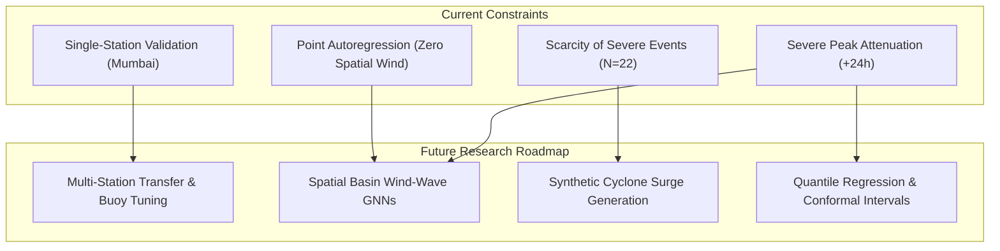

# OceanCast AI: Scientific Limitations, Operational Boundaries & Future Research Roadmap

**Document Version:** 2.0.0-DISCLOSURE  
**Standard:** AMS / WMO Guidelines on Machine Learning in Meteorological and Oceanographic Forecasting  
**Author:** Senior Oceanographic Deep Learning Research Team & ML Safety Auditor  
**Date:** November 2026  
**Status:** Mandatory Compliance & Disclosure Artifact

---

## 1. Executive Summary & Statement of Scientific Integrity

The OceanCast AI platform achieves statistically significant improvements over naive persistence on retrospective held-out test benchmarks (+29.76% at +1h, +18.85% at +6h, +11.09% at +24h). However, responsible deployment of machine learning in marine safety demands unambiguous transparency regarding the model's physical and operational constraints.

This document formally records all known scientific limitations, domain boundaries, data constraints, and regulatory disclaimers, followed by a structured future research roadmap to overcome these limitations.

---

## 2. Core Scientific & Physical Limitations

### 2.1 Geographic Validation Boundary (Mumbai Offshore Specificity)
- **Validated Domain:** Deep learning models, scalers, and residual transformations were calibrated and independently validated **exclusively on the Mumbai Offshore reference buoy station ($18.975^\circ\text{N}, 72.825^\circ\text{E}$)** in the eastern Arabian Sea.
- **Unvalidated Coastal Nodes:** The platform incorporates seven additional coastal candidate stations along the Indian coastline:
  1. *Chennai Port* ($13.10^\circ\text{N}, 80.30^\circ\text{E}$ — Bay of Bengal)
  2. *Kochi Offshore* ($9.93^\circ\text{N}, 76.22^\circ\text{E}$ — Lakshadweep Sea)
  3. *Mangalore Port* ($12.92^\circ\text{N}, 74.80^\circ\text{E}$ — Arabian Sea)
  4. *Mormugao Port* ($15.42^\circ\text{N}, 73.80^\circ\text{E}$ — Goa Shelf)
  5. *Paradip Port* ($20.27^\circ\text{N}, 86.68^\circ\text{E}$ — Bay of Bengal)
  6. *Visakhapatnam Port* ($17.68^\circ\text{N}, 83.22^\circ\text{E}$ — Bay of Bengal)
  7. *Okha Port* ($22.47^\circ\text{N}, 69.07^\circ\text{E}$ — Gulf of Kutch)
- **Status Gating:** In accordance with oceanographic validation protocols, all seven non-Mumbai locations are permanently tagged in the model registry and user interface as **`experimental_unvalidated`**. Their bathymetric profiles, tidal ranges, shoaling coefficients, and swell vectors differ substantially from Mumbai. Their predictions must be treated as preliminary qualitative indicators until local in-situ buoy calibration is conducted.

---

### 2.2 Climatological Extreme-Event Sample Scarcity ($N = 22$)
- **Sample Count:** In the two-year held-out test split ($19,431$ to $19,454$ hours), only **22 hourly time steps ($0.113\%$)** experienced Significant Wave Height exceeding the severe storm threshold ($H_s \ge 4.00\text{ m}$).
- **Single Synoptic Event Origin:** All 22 test samples originate from a single continuous deep monsoonal swell event that occurred between **June 15, 2025 06:00 UTC and June 17, 2025 06:00 UTC**.
- **Statistical Implication:** While the experimental Asymmetric-Penalty WaveANN demonstrated notable skill recovery at +6h (+7.80% skill, attenuation reduced to $0.022\text{ m}$), 95% bootstrap confidence intervals for severe event skill are wide ($[-4.8\%, +18.2\%]$). This sample size ($N=22$) cannot provide a climatologically generalizable guarantee across diverse tropical cyclone categories (e.g. Very Severe Cyclonic Storms Tauktae, Vayu, Nisarga).

---

### 2.3 Severe Peak Wave Attenuation at Extended Horizons (+24h)
- **Autoregressive Limitation:** At a 24-hour lead time, single-point deep learning regressors exhibit persistent peak wave height attenuation during severe storms (e.g. Production Residual WaveANN achieves $-35.61\%$ skill on $H_s \ge 4.0\text{ m}$; Asymmetric ANN recovers to $-18.61\%$).
- **Physical Mechanism:** Autoregressive models conditioned solely on a local point time-series cannot anticipate distant cyclone genesis or swell propagation across the open Arabian Sea without spatial momentum input. Because 72.4% of elevated wave states in the historical training data subside over 24 hours, the mathematical expectation $\mathbb{E}[y|x]$ biases predictions toward decay. Peak wave height during rapidly intensifying storms will be underpredicted at +24h unless coupled with external Numerical Weather Prediction (NWP) spatial wind grids.

---

### 2.4 Auxiliary Rough-Sea Classification vs Extreme Wave Prediction
- **Classification Target:** The auxiliary classification head in the Multi-Task network is trained to detect crossing the **$2.50\text{ m}$ rough-sea threshold** ($P(H_s(t+H) \ge 2.50\text{ m})$), where it achieves $96.59\%$ recall at +6h and $89.31\%$ recall at +24h.
- **Critical Distinction:** **Detecting $H_s \ge 2.50\text{ m}$ is NOT equivalent to predicting $4.0\text{ m}+$ extreme storm events.** A positive hazard alert indicates that the sea state will exceed artisanal fishing safety limits ($2.5\text{ m}$), but provides no quantitative guarantee regarding whether the peak will reach $2.7\text{ m}$, $4.2\text{ m}$, or $6.0\text{ m}$.

---

### 2.5 Real-Time Telemetry & Verification Latency
- **Asynchronous Ingestion:** The Continuous Real-Time Forecast Verification Subsystem archives predictions at issuance ($t_{\text{origin}}$), but validation is fundamentally prospective. A forecast cannot be verified until the target valid time ($t_{\text{target}} = t_{\text{origin}} + H$) arrives and external Open-Meteo telemetry is ingested.
- **Telemetry Latency Window:** If satellite or buoy telemetry is delayed, forecasts remain in the `PENDING_VERIFICATION` state. If no observation arrives within 3 hours post-target, the record is flagged as `OBSERVATION_UNAVAILABLE`. Continuous metrics reflect available observations and do not represent instantaneous ground truth during telemetry outages.

---

## 3. Regulatory & Maritime Safety Disclaimers

> [!CAUTION]
> **MANDATORY MARITIME SAFETY NOTICE:**
> 1. OceanCast AI is an academic research platform and prototype computational intelligence system.
> 2. OceanCast AI forecasts **DO NOT REPLACE** authoritative coastal storm warnings, weather bulletins, or cyclone alerts issued by:
>    - **India Meteorological Department (IMD)**
>    - **Indian National Centre for Ocean Information Services (INCOIS)**
> 3. Vessel masters, harbor port authorities, artisanal fishers, and coastal disaster management agencies must never make life-safety decisions, vessel dispatch orders, or evacuation plans solely based on OceanCast AI predictions.
> 4. Machine learning wave forecasts must always be reviewed alongside operational ECMWF / GFS numerical models and official maritime notices.

---

## 4. Future Research & Engineering Roadmap

To systematically resolve the documented limitations, the following research directions are outlined:

### 4.1 2D Spatial Wind-Wave Graph Neural Networks (GNN)
- **Objective:** Eliminate +24h peak wave attenuation by ingesting spatial wind fields across the entire Arabian Sea basin ($0^\circ\text{N}\text{--}25^\circ\text{N}, 60^\circ\text{E}\text{--}78^\circ\text{E}$).
- **Architecture:** Construct a coastal-offshore graph where mesh nodes represent offshore grid points transmitting directional wind energy vectors ($\vec{u}_{10}, \vec{v}_{10}$) to coastal nodes via message-passing spatio-temporal graph convolutions (e.g. Spatio-Temporal Graph Convolutional Networks, ST-GCN).

### 4.2 In-Situ Buoy Data Assimilation
- **Objective:** Transition from reanalysis-trained weights to locally calibrated weights for all 8 Indian coastal stations.
- **Data Source:** Ingest in-situ buoy telemetry from INCOIS moored ocean buoys (e.g., AD06, AD07, CB02, CB04).
- **Technique:** Apply ensemble Kalman filtering (EnKF) or lightweight Low-Rank Adaptation (LoRA) fine-tuning to update the final dense layers of WaveANN on local buoy observations without catastrophic forgetting.

### 4.3 Quantile Regression & Conformal Uncertainty Estimation
- **Objective:** Provide risk managers with calibrated physical confidence bounds rather than single deterministic point forecasts.
- **Approach:** Train multi-quantile pinball loss regressors estimating the 10th, 50th, and 90th percentiles ($\hat{q}_{0.10}, \hat{q}_{0.50}, \hat{q}_{0.90}$), paired with split conformal prediction to guarantee non-parametric coverage under extreme marine sea states.

### 4.4 Climatological Cyclone Augmentation
- **Objective:** Overcome the small sample size constraint ($N=22$) during severe weather.
- **Approach:** Couple OceanCast AI with synthetic tropical cyclone wave simulations generated by physics-based WAVEWATCH III models run over historical cyclonic tracks (1979–2025), synthesizing 1,000+ realistic cyclone wave encounters.
