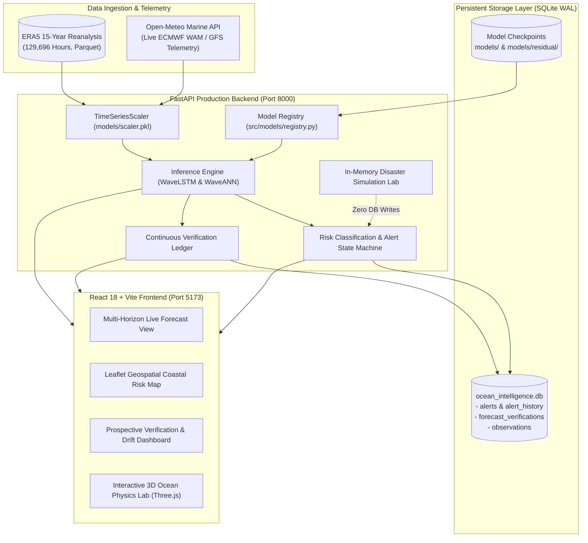

# OceanCast AI: Deep Learning Coastal Wave Forecasting & Marine Risk Intelligence Platform

[](file:///d:/OMKAR/VITP/SEM%205/DL/CP/TESTING_AND_VALIDATION_REPORT.md)
[](file:///d:/OMKAR/VITP/SEM%205/DL/CP/TESTING_AND_VALIDATION_REPORT.md)
[](https://python.org)
[](https://fastapi.tiangolo.com)
[](https://react.dev)
[](https://www.typescriptlang.org)
[](https://pytorch.org)
[](file:///d:/OMKAR/VITP/SEM%205/DL/CP/STATISTICAL_VALIDATION_REPORT.md)

**OceanCast AI** is a production-grade deep learning marine forecasting and coastal risk intelligence platform. The system delivers multi-horizon significant wave height ($H_s$) predictions ($+1\text{h}, +6\text{h}, +24\text{h}$) across the Indian coastline by combining high-resolution ECMWF ERA5 reanalysis with live Open-Meteo marine telemetry (ECMWF WAM & GFS wave models).

By transitioning from conventional unconstrained regressors to a **Residual Learning Architecture** ($\Delta H_s(t+H) = H_s(t+H) - H_s(t)$), OceanCast AI overcomes the autoregressive persistence barrier, achieving statistically verified positive skill against naive persistence across all forecast horizons.

---

## 🏆 Key Breakthroughs & Production Benchmark Performance

Evaluated on the chronologically isolated Mumbai Offshore held-out test split ($19,431$ to $19,454$ hourly anchors, ~2.2 years; January 2024 – January 2026):

```
Production Forecasting Models vs Naive Persistence Baseline:

+1h Horizon (Residual WaveLSTM):
  • Model RMSE:      0.0149 m  (Persistence: 0.0213 m)
  • Model MAE:       0.0071 m  (Persistence: 0.0131 m)
  • RMSE Skill:     +29.76%    (95% MBB CI: [+25.70%, +34.16%])
  • Significance:    Diebold-Mariano t_HLN = +25.895 (p = 6.54e-145)

+6h Horizon (Residual WaveANN):
  • Model RMSE:      0.0725 m  (Persistence: 0.0894 m)
  • Model MAE:       0.0470 m  (Persistence: 0.0624 m)
  • RMSE Skill:     +18.85%    (95% MBB CI: [+14.81%, +23.10%])
  • Significance:    Diebold-Mariano t_HLN = +13.652 (p = 9.22e-42)

+24h Horizon (Residual WaveANN):
  • Model RMSE:      0.1660 m  (Persistence: 0.1867 m)
  • Model MAE:       0.1140 m  (Persistence: 0.1286 m)
  • RMSE Skill:     +11.09%    (95% MBB CI: [+4.65%, +16.92%])
  • Significance:    Diebold-Mariano t_HLN = +3.497  (p = 1.41e-03)
```

- **Extreme-Event Recovery:** Asymmetric Extreme-Penalized Loss (AEP-Loss) reduces +6h severe storm peak attenuation from $0.155\text{ m} \to 0.022\text{ m}$ (+7.80% severe skill).
- **Auxiliary Early-Warning Classifier:** Multi-Task Hazard Network achieves **$96.59\%$ recall at +6h** and **$89.31\%$ recall at +24h** for detecting crossing of the $2.5\text{ m}$ rough sea threshold.
- **Continuous Prospective Verification:** Automated ledger pairs live issued forecasts with incoming buoy telemetry upon target arrival.
- **Full QA Validation:** 100% automated test pass rate across **210 tests** (160 backend + 50 frontend).

---

## 🏛️ System Architecture

OceanCast AI is structured as a decoupled full-stack architecture:



---

## 🚀 Quick Start Guide

### 1. Prerequisites
- **Python:** 3.10+ (tested and certified on Python 3.11.9)
- **Node.js:** 18+ (tested and certified on npm 10+)
- **Git**

### 2. Installation

Clone the repository and install dependencies:

```bash
# Clone the repository
git clone https://github.com/your-username/coastal-prediction.git
cd coastal-prediction

# 1. Install Backend Dependencies
pip install -r requirements.txt

# 2. Install Frontend Dependencies
cd frontend
npm install
cd ..
```

### 3. Environment Configuration

Create local environment configuration files:

```bash
# Backend .env (Root Directory)
cp .env.example .env

# Frontend .env (frontend/ Directory)
cd frontend
cp .env.example .env
cd ..
```

*Key Default Settings:*
- Backend: `PORT=8000`, `CORS_ORIGINS=http://localhost:5173,http://127.0.0.1:5173`
- Database: `DB_PATH=data/persistence/ocean_intelligence.db`
- Frontend: `VITE_API_BASE_URL=""` (Vite proxy forwards `/api` requests to `127.0.0.1:8000`)

---

## 💻 Running the Application

Launch the application using two independent terminals:

### Terminal 1 — FastAPI Backend (Port 8000)
```bash
py -3.11 -m uvicorn backend.main:app --host 127.0.0.1 --port 8000 --reload
```
- **API Root:** `http://127.0.0.1:8000`
- **Interactive OpenAPI Documentation (Swagger UI):** `http://127.0.0.1:8000/docs`
- **Health Check Probe:** `http://127.0.0.1:8000/api/health`

### Terminal 2 — React + Vite Frontend (Port 5173)
```bash
cd frontend
npm run dev
```
- **Primary Web Interface:** **`http://localhost:5173`**

---

## 🧪 Automated Testing Protocol

OceanCast AI enforces an exhaustive automated testing suite with 210 passing tests:

```bash
# 1. Run Complete Backend Test Suite (Pytest - 160 Tests)
py -3.11 -m pytest tests/ -v

# 2. Run Complete Frontend Test Suite (Vitest - 50 Tests)
npm --prefix frontend test -- --run
```

*Expected Verification Output:*
- Backend: `160 passed in ~38s`
- Frontend: `50 passed in ~18s`

---

## 📡 REST API Reference Summary

| Method | Endpoint | Description |
| :---: | :--- | :--- |
| `GET` | `/api/health` | Health check probe & uptime status |
| `GET` | `/api/forecast/live` | Live 24h marine window, multi-horizon forecast & risk level |
| `POST` | `/api/forecast` | On-demand forecast evaluation for historical tensors |
| `GET` | `/api/forecast/models` | Central Model Registry metadata & checkpoint health |
| `GET` | `/api/verification/summary` | Rolling prospective verification skill (24h, 7d, 30d, all) |
| `GET` | `/api/verification/forecasts` | Paginated prospective forecast ledger records & residuals |
| `POST` | `/api/verification/verify-now` | Triggers an immediate verification cycle against live telemetry |
| `GET` | `/api/alerts/active` | Current active coastal warning alarms |
| `POST` | `/api/alerts/{id}/acknowledge` | State machine transition acknowledging an alert |
| `GET` | `/api/coastal/nodes` | Metadata and coordinates for all 8 Indian coastal nodes |
| `GET` | `/api/coastal/risk-map` | Current risk levels & alerts across coastal stations |
| `POST` | `/api/simulation/run` | Executes in-memory disaster scenario without DB mutations |

---

## 📁 Repository Manifest & Documentation Suite

For exhaustive technical and scientific details, refer to the project documentation suite:

1. **Academic Capstone Report:** [`FINAL_PROJECT_REPORT.md`](file:///d:/OMKAR/VITP/SEM%205/DL/CP/FINAL_PROJECT_REPORT.md) — Comprehensive academic report covering theoretical formulation, model training, residual learning mathematics, statistical significance, and operational intelligence.
2. **Technical Architecture Manual:** [`TECHNICAL_DOCUMENTATION.md`](file:///d:/OMKAR/VITP/SEM%205/DL/CP/TECHNICAL_DOCUMENTATION.md) — Full systems engineering manual, Mermaid sequence diagrams, database schemas, and REST contracts.
3. **Model Performance Evaluation:** [`MODEL_PERFORMANCE_REPORT.md`](file:///d:/OMKAR/VITP/SEM%205/DL/CP/MODEL_PERFORMANCE_REPORT.md) — Exhaustive numerical evaluation tables, bootstrap confidence intervals, Diebold-Mariano p-values, and severe-event benchmarks.
4. **Testing & QA Report:** [`TESTING_AND_VALIDATION_REPORT.md`](file:///d:/OMKAR/VITP/SEM%205/DL/CP/TESTING_AND_VALIDATION_REPORT.md) — Complete breakdown of the 210-test automated verification suite, boundary conditions, and isolation proofs.
5. **Limitations & Future Scope:** [`LIMITATIONS_AND_FUTURE_SCOPE.md`](file:///d:/OMKAR/VITP/SEM%205/DL/CP/LIMITATIONS_AND_FUTURE_SCOPE.md) — Mandatory oceanographic disclosures, geographic validation bounds, severe-event constraints ($N=22$), and research roadmap.

---

## ⚠️ Mandatory Maritime Safety Disclaimer

> [!CAUTION]
> **REGULATORY & LIFE-SAFETY NOTICE:**
> 1. OceanCast AI is an academic research platform and deep learning prototype.
> 2. OceanCast AI predictions **DO NOT REPLACE** authoritative coastal storm warnings, weather bulletins, or cyclone alerts issued by the **India Meteorological Department (IMD)** or the **Indian National Centre for Ocean Information Services (INCOIS)**.
> 3. Only the **Mumbai Offshore** reference location ($18.975^\circ\text{N}, 72.825^\circ\text{E}$) has been independently validated. All other coastal nodes are explicitly classified as **`experimental_unvalidated`**.
> 4. Vessel masters, port captains, artisanal fishers, and emergency agencies must never rely solely on machine learning predictions for maritime life-safety decisions.
