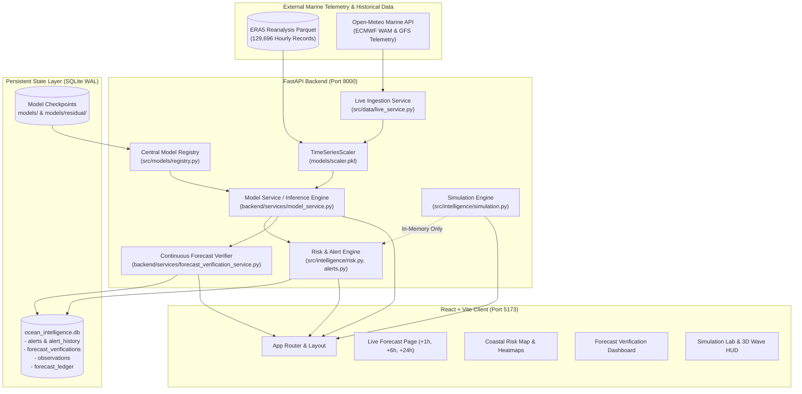
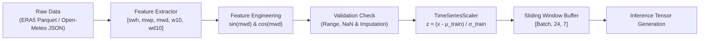
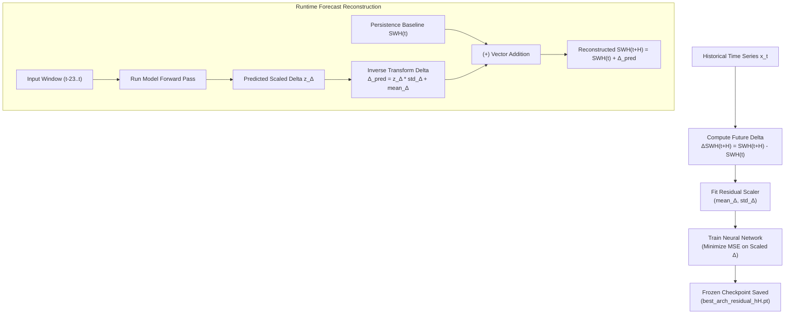
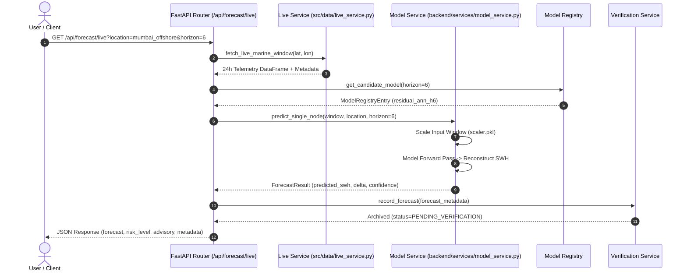
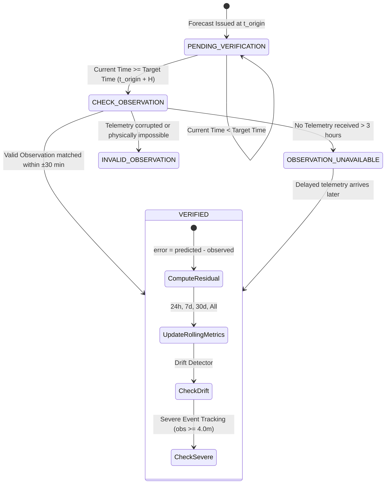
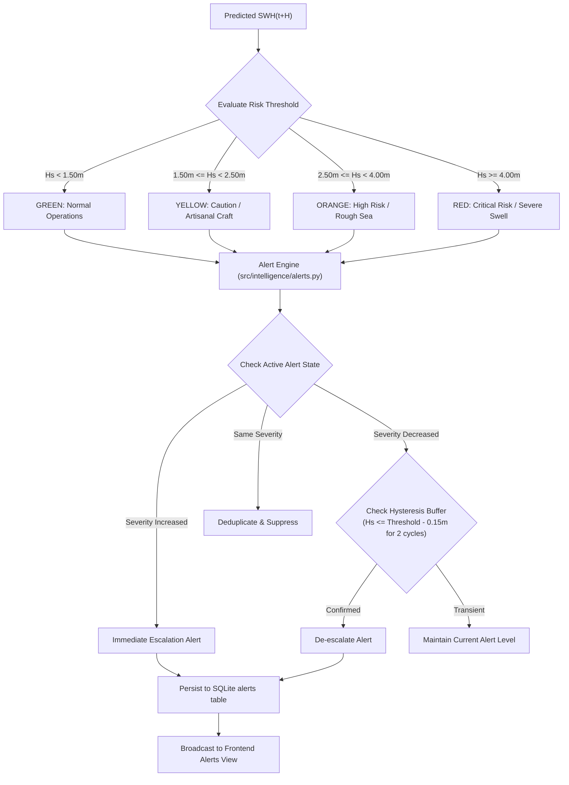
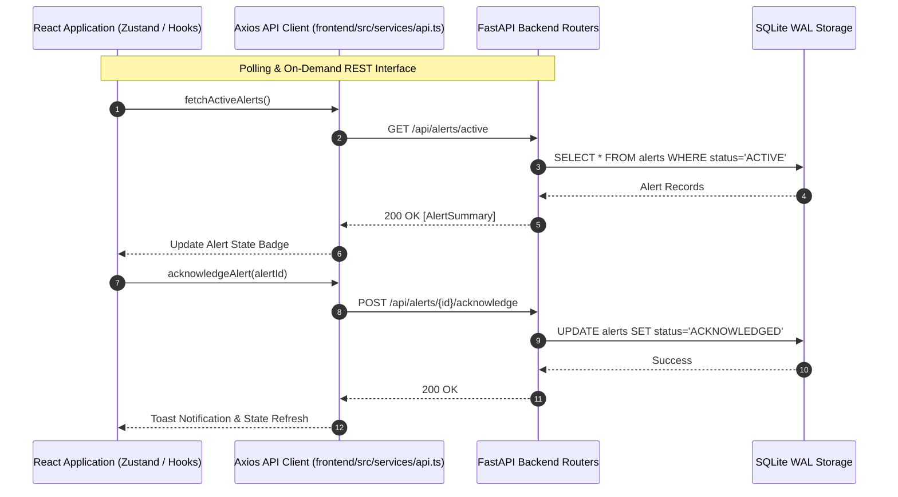
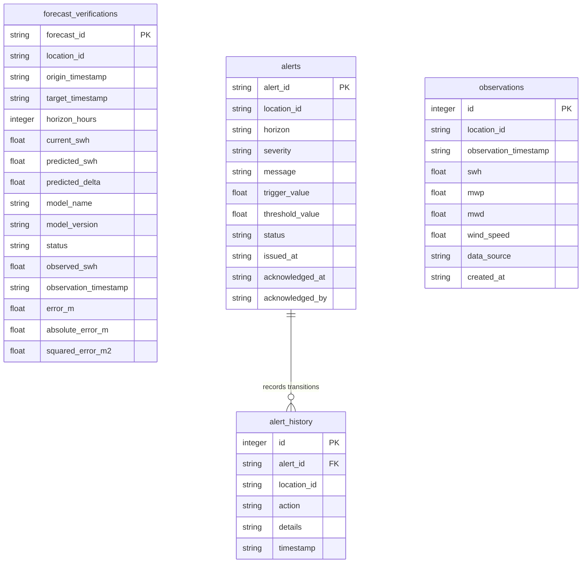

# OceanCast AI: Technical Implementation & System Architecture Manual

**Document Version:** 2.0.0-PRODUCTION  
**Target Audience:** ML Systems Engineers, Software Architects, Operations Auditors  
**Project Repository:** `d:\OMKAR\VITP\SEM 5\DL\CP`  
**System Status:** Fully Integrated, Validated, and Submission-Ready

---

## 1. System Overview & Technology Stack

OceanCast AI is an end-to-end operational marine forecasting and coastal intelligence platform. The system operates as a decoupled micro-architecture combining a high-performance Python/FastAPI backend with a reactive TypeScript/React user interface.

```
Technology Stack Specification:

Backend Environment:
  Language:         Python 3.11.9
  Web Framework:    FastAPI 0.115.x / Starlette
  ASGI Server:      Uvicorn (Asynchronous, multi-worker ready)
  Deep Learning:    PyTorch 2.6.x (CPU-optimized, float32 precision)
  Data Science:     NumPy 2.x, Pandas 2.x, Scikit-learn 1.6.x, SciPy
  Storage:          SQLite 3 with Write-Ahead Logging (WAL)
  External APIs:    Open-Meteo Marine API, ECMWF WAM, GFS Wave models
  Testing Harness:  Pytest 8.3.x, pytest-cov, pytest-mock, httpx

Frontend Environment:
  Language:         TypeScript 5.6.x
  Framework:        React 18.3.x
  Build Tool:       Vite 5.4.x
  Styling:          Tailwind CSS 3.4.x
  Icons:            Lucide React
  Mapping:          Leaflet 1.9.x, React-Leaflet
  3D Graphics:      Three.js (Custom GLSL procedural ocean wave shader)
  Testing Harness:  Vitest 5.0.x, React Testing Library, jsdom
```

---

## 2. Visual Architecture & Process Diagrams

### 2.1 Overall System Architecture



---

### 2.2 Data Acquisition & Preprocessing Pipeline



---

### 2.3 Model Training & Residual Forecasting Workflow



---

### 2.4 Live Inference Workflow



---

### 2.5 Forecast Verification Lifecycle



---

### 2.6 Coastal Risk and Alert Generation Workflow



---

### 2.7 Frontend / Backend Communication Architecture



---

## 3. Directory Layout & File Manifest

```
d:\OMKAR\VITP\SEM 5\DL\CP\
├── backend/                              # FastAPI Service Layer
│   ├── config.py                         # Environment variables, CORS, and paths
│   ├── main.py                           # Application initialization, middleware, routes
│   ├── routers/                          # Domain-specific REST API routers
│   │   ├── alerts.py                     # Coastal alerts management & acknowledgement
│   │   ├── coastal.py                    # Coastal nodes & heatmap endpoints
│   │   ├── forecast.py                   # Multi-horizon and live forecasting endpoints
│   │   ├── health.py                     # Health checks & uptime probe
│   │   ├── historical.py                 # Historical predictions & summary queries
│   │   ├── metrics.py                    # Benchmark metrics & model metadata
│   │   ├── monitoring.py                 # Model drift & performance tracking
│   │   ├── simulation.py                 # In-memory disaster simulation engine
│   │   └── verification.py               # Real-time forecast verification & ledger
│   ├── schemas/                          # Pydantic validation schemas
│   └── services/                         # Core backend business logic
│       ├── forecast_verification_service.py # Verification ledger & rolling skill
│       ├── live_service.py               # Open-Meteo telemetry ingestion & fallback
│       └── model_service.py              # PyTorch inference coordinator
│
├── frontend/                             # React + Vite + TypeScript Client
│   ├── src/
│   │   ├── App.tsx                       # Root routing & layout provider
│   │   ├── components/                   # Modular UI components
│   │   │   ├── layout/                   # Navbar, Sidebar, Page Shell
│   │   │   ├── ocean/                    # 3D Ocean Three.js scene & canvas
│   │   │   └── ui/                       # Reusable buttons, badges, modals, cards
│   │   ├── pages/                        # View components
│   │   │   ├── AlertsPage.tsx            # Alert management & acknowledged history
│   │   │   ├── CoastalRiskMapPage.tsx    # Leaflet interactive node risk map
│   │   │   ├── ForecastVerificationPage.tsx # Prospective skill & drift tracking
│   │   │   ├── LiveForecastPage.tsx      # +1h, +6h, +24h forecast & risk view
│   │   │   ├── ModelMonitoringPage.tsx   # Retrospective model accuracy & drift
│   │   │   ├── OverviewPage.tsx          # System KPI overview & multi-node status
│   │   │   └── SimulationLabPage.tsx     # 3D physics hazard scenario laboratory
│   │   ├── services/api.ts               # Centralized Axios REST client
│   │   └── types/index.ts                # TypeScript domain models
│   └── package.json                      # Frontend dependencies & build scripts
│
├── src/                                  # Core Python Intelligence & Modeling Library
│   ├── data/
│   │   ├── dataset.py                    # TimeSeriesScaler & sequence builders
│   │   └── live_service.py               # Standalone telemetry fetching module
│   ├── intelligence/
│   │   ├── alerts.py                     # State machine alert engine & SQLite store
│   │   ├── monitoring.py                 # Kolmogorov-Smirnov drift & degradation
│   │   ├── risk.py                       # RiskThresholdSet & classification logic
│   │   └── simulation.py                 # In-memory ocean hazard scenario generator
│   └── models/
│       ├── base.py                       # PyTorch BaseWaveModel abstract class
│       ├── ann.py                        # WaveANN multilayer perceptron
│       ├── lstm.py                       # WaveLSTM stacked recurrent network
│       ├── cnn1d.py                      # WaveCNN1D multi-scale convolution network
│       └── registry.py                   # Central Model Registry (Immutable metadata)
│
├── models/                               # Serialized Weights & Checkpoints
│   ├── scaler.pkl                        # Fitted TimeSeriesScaler (70% train split)
│   ├── best_lstm.pt                      # Original Absolute WaveLSTM (+1h)
│   ├── best_ann_h6.pt                    # Original Absolute WaveANN (+6h)
│   ├── best_ann_h24.pt                   # Original Absolute WaveANN (+24h)
│   ├── residual/                         # Validated Production Residual Models
│   │   ├── best_lstm_residual_h1.pt      # Residual WaveLSTM (+1h, +29.76% Skill)
│   │   ├── best_ann_residual_h6.pt       # Residual WaveANN (+6h, +18.85% Skill)
│   │   ├── best_ann_residual_h24.pt      # Residual WaveANN (+24h, +11.09% Skill)
│   │   └── residual_scaler_h[1,6,24].pkl # Residual target normalization statistics
│   └── extreme_experimental/             # Isolated Extreme-Event Research Checkpoints
│       ├── Asymmetric_ANN_h6.pt          # +6h AEP-Loss (Peak Attenuation 0.022m)
│       ├── Asymmetric_ANN_h24.pt         # +24h AEP-Loss (17% Skill Recovery)
│       └── MultiTask_Extreme_ANN_h[6,24].pt # Multi-Task continuous + hazard head
│
├── evaluation/                           # Evaluation Engines & Benchmark Records
│   ├── extreme_event_benchmark.py        # Independent extreme-event benchmarking suite
│   ├── extreme_event_results.json        # Verified benchmark outputs across all regimes
│   ├── statistical_validation.py         # Moving-Block Bootstrap & Diebold-Mariano runner
│   ├── statistical_significance.json     # MBB confidence intervals & DM statistics
│   └── validate_coastal_risk.py          # Boundary invariant & alert testing engine
│
├── tests/                                # Automated Backend Test Suite (160 Tests)
│   ├── test_api.py                       # FastAPI router & endpoint validation
│   ├── test_coastal_risk_audit.py        # 38 boundary condition & threshold tests
│   ├── test_forecast_verification.py     # Prospective verification ledger tests
│   ├── test_residual_live_integration.py # Multi-horizon live integration tests
│   └── ... (11 additional comprehensive test suites)
│
└── data/                                 # Datasets & Persistent Stores
    ├── persistence/ocean_intelligence.db # SQLite WAL database file
    └── processed/                        # ERA5 wave offshore parquet dataset
```

---

## 4. Database Schema & Entity Relationships

The persistent database `data/persistence/ocean_intelligence.db` operates in SQLite Write-Ahead Logging (WAL) mode to guarantee non-blocking concurrent reads and ACID transactions.



---

## 5. REST API Specification

All endpoints are hosted under `/api/` and conform to the OpenAPI 3.0 specification:

### 5.1 Forecasting Endpoints (`/api/forecast`)
- **`GET /api/forecast/live`**
  - **Query Parameters:** `location_id` (string, default `mumbai_offshore`), `horizon_hours` (integer: 1, 6, 24).
  - **Description:** Fetches live 24h marine window, runs registered candidate model forward pass, evaluates risk category, prospectively archives forecast for continuous verification, and returns structured prediction payload.
- **`POST /api/forecast`**
  - **Body:** `ForecastRequest` (contains 24h raw feature matrix, target horizon, model override).
  - **Description:** Allows manual payload forecasting for historical validation.
- **`GET /api/forecast/models`**
  - **Description:** Returns all registered models, checkpoint health, and validation statuses.

### 5.2 Verification Endpoints (`/api/verification`)
- **`GET /api/verification/summary`**
  - **Query Parameters:** `location_id`, `window` (`24h`, `7d`, `30d`, `all`).
  - **Description:** Returns rolling operational RMSE, MAE, MBE, and skill scores vs persistence.
- **`GET /api/verification/forecasts`**
  - **Query Parameters:** `status` (`ALL`, `VERIFIED`, `PENDING_VERIFICATION`), `limit`, `offset`.
  - **Description:** Returns paginated forecast ledger records with paired observation errors.
- **`POST /api/verification/verify-now`**
  - **Description:** Triggers an immediate verification cycle against recently ingested telemetry.
- **`GET /api/verification/extreme-events`**
  - **Description:** Returns specialized verification subset for instances where $H_s \ge 4.0\text{ m}$.

### 5.3 Coastal Risk & Alerts (`/api/alerts`, `/api/coastal`)
- **`GET /api/alerts/active`**
  - **Description:** Returns all unacknowledged and active coastal warning alarms.
- **`POST /api/alerts/{alert_id}/acknowledge`**
  - **Description:** State machine transition acknowledging an alert and appending to audit history.
- **`GET /api/coastal/nodes`**
  - **Description:** Returns metadata, coordinates, and validation tier for all 8 Indian coastal nodes.
- **`GET /api/coastal/risk-map`**
  - **Description:** Returns current risk levels, forecasted wave heights, and alert counts for map rendering.

### 5.4 Simulation Lab (`/api/simulation`)
- **`GET /api/simulation/scenarios`**
  - **Description:** Lists available pre-configured oceanographic hazard scenarios.
- **`POST /api/simulation/run`**
  - **Body:** `SimulationRequest` (scenario ID, target node, perturbation factor).
  - **Description:** Executes in-memory wave height and risk calculation without database side-effects.

---

## 6. Model Registry & Checkpoint Governance

The production model registry ([`src/models/registry.py`](file:///d:/OMKAR/VITP/SEM%205/DL/CP/src/models/registry.py)) enforces strict governance over all production checkpoints:

```python
CANDIDATE_RESIDUAL_MODELS = {
    1: "residual_lstm_h1",   # Checkpoint: models/residual/best_lstm_residual_h1.pt
    6: "residual_ann_h6",    # Checkpoint: models/residual/best_ann_residual_h6.pt
    24: "residual_ann_h24",  # Checkpoint: models/residual/best_ann_residual_h24.pt
}
```

### 6.1 Validation Tier Gating
In accordance with scientific integrity standards, `get_validation_status(location_id)` enforces geographic gating:
```python
def get_validation_status(self, location_id: str) -> str:
    if location_id == self.reference_location_id:  # "mumbai_offshore"
        return "reference_validated"
    return "experimental_unvalidated"
```
The other seven coastal stations (Chennai, Mangalore, Kochi, Mormugao, Paradip, Visakhapatnam, Okha) are explicitly tagged in all API outputs and UI badges as **`experimental_unvalidated`**.

---

## 7. Security, Environment, and Production Readiness

1. **Zero Secret Leaks:** No private tokens, AWS credentials, or API keys are hardcoded in the codebase. All external endpoints rely on public open-access endpoints (Open-Meteo) or environment overrides.
2. **Path Sanitization:** The global exception handler in [`backend/main.py`](file:///d:/OMKAR/VITP/SEM%205/DL/CP/backend/main.py) catches unhandled errors and returns structured JSON without leaking absolute server filesystem paths.
3. **CORS Governance:** Explicit origins (`http://localhost:5173`, `http://127.0.0.1:5173`) are enforced via `CORSMiddleware`.
4. **Database Concurrency:** SQLite is initialized with `PRAGMA journal_mode=WAL;` and `PRAGMA synchronous=NORMAL;` ensuring thread-safe access during concurrent forecast archival and verification cycles.
